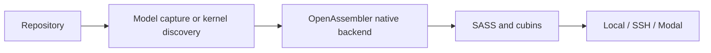

<p align="center">
  
</p>

# OpenAssembler

**Compile Python models and GPU kernels to native NVIDIA SASS and cubins.**

OpenAssembler targets **A100 / SM80**, with its own instruction selection, register allocation, scheduling, and machine-code encoder. Compile supported Python, CUDA C/C++/C, or PTX sources, inspect the generated code, and run the saved artifacts locally, over SSH, or on Modal.

<p align="center">
  <strong>v0.3.1 · Python 3.12+ · Linux and macOS · Apache 2.0</strong><br>
  <a href="#quick-start">Quick start</a> ·
  <a href="docs/COMMANDS.md">Commands</a> ·
  <a href="docs/STATUS.md">Architecture &amp; status</a> ·
  <a href="docs/research/README.md">Research</a>
</p>

> [!NOTE]
> OpenAssembler is under active development. Bug reports, minimal reproducers,
> and kernel optimization proposals are welcome in [Issues](https://github.com/lucialuka/OpenAssembler/issues).

## Quick start

Install from a checkout using **Python 3.12 or newer**. 

```sh
git clone https://github.com/lucialuka/OpenAssembler.git
cd OpenAssembler
```
If you have access to Nvidia A100, just access them through ssh or anything you have, if you do not have, you can use them in [Modal](https://modal.com/docs/guide) (which gives you $30 of free credits) after you install it:

```sh
pip install modal
modal setup
```

You can also install OpenAssembler through Homebrew:
<details>
<summary><strong>Install with Homebrew</strong></summary>

```sh
brew tap lucialuka/openassembler https://github.com/lucialuka/OpenAssembler
brew install openassembler
modal setup
```

The formula installs Python 3.12, the compiler/data tree, and the Modal CLI.
It currently packages the `CLI` branch; use the source installation above for
the current checkout. See the [Homebrew guide](docs/HOMEBREW.md) for formula
versions and CUDA setup.

</details>

## Compile a repository

The same repository path works throughout the workflow:

```sh
openassembler inspect /path/to/repo --json
openassembler compile /path/to/repo --backend modal/user@a100 --verify
openassembler run /path/to/repo --backend modal/user@a100
```

`run` uses saved artifacts; `cnr` compiles and runs in one step. A source path
alone is shorthand for `compile PATH`. Both `compile` and `cnr` default to the
current directory. Add `--dry-run` to plan work without building or submitting a
job; use `inspect` for static coverage without executing user code.

| Input | Compilation route |
|---|---|
| Python model repository | A `[model]` factory in `openassembler.toml` selects CPU graph capture and native forward/backward kernels. |
| Python GPU kernels | Typed `@kernel` functions compile through OpenAssembler's Python subset. |
| CUDA C/C++/C device sources | `__global__` kernels go through `nvcc --ptx`, then OpenAssembler's native backend. |
| PTX | `.entry` kernels go directly to the native backend. |

`[model]` selects model compilation automatically. Use `--frontend native` to
request static kernel discovery explicitly. Discovery respects Git's tracked
and non-ignored files; it does not infer arbitrary host launches, CMake linking,
or custom model operators. Build failures save `OUT/compile-error.json` in the
selected output directory. See the [coverage audit](docs/CODEBASE_AUDIT.md).

Use `--backend modal` from a workstation, `--backend user@a100` for an SSH
host, or `--backend local` inside a Linux GPU terminal. Native kernel compilation
needs CUDA tools; GPU execution needs a driver. macOS compilation uses Colima.
The [workflow guide](docs/REPOSITORY_WORKFLOW.md) covers remote dependencies and
setup. Standalone kernel pipelines need buffers and launches in `--spec launch.json`.

Directory builds use `REPO/output/`; single files use `./output/`. Kernel builds
contain `cubin/`, optional `sass/`, and `manifest.json`. Models add a launch plan,
weights, and a native ownership ledger. Cubins are loaded by the CUDA driver;
SASS is their readable instruction listing. `--no-sass` omits listings. For a
custom location, use the same `--out-dir DIR` when compiling and running.

## Native Python models

Configure a CPU FP32 `torch.nn.Module` factory and exact input shapes in
`openassembler.toml`. The model bridge captures supported graphs and emits
native forward, backward, MSE, and plain SGD kernels.

Supported operators include linear layers, residual arithmetic, batched products,
softmax, GELU, affine LayerNorm, permutations, and concatenation. Arithmetic is
FP32 by default; explicit FP16-RNE operands with FP32 accumulation have their
own numerical contract.

Try the [Tensor Core MLP](examples/native_tensor_model/model.py) or
[attention block](examples/native_attention_model/model.py), then verify a saved
model without recompiling:

```sh
openassembler cnr examples/native_tensor_model --backend modal/user@a100 --verify
openassembler cnr examples/native_attention_model --backend modal/user@a100 --verify
openassembler run examples/native_attention_model --backend modal/user@a100 --verify-application
```

Models use saved OA-owned GPU modules, with optional CUDA Graph training replay,
immutable storage views, guarded buffer reuse, and a validated bundle cache.
FP16 batched products support equal batches through 32 and matrix dimensions
through 512, including tails. Attention is composed from native operations;
masks, broadcasting, fused attention, and arbitrary dynamic shapes remain
outside this contract. Read the [native model guide](docs/research/ideas/native-model-bridge.md)
for precision, Python APIs, deployment, and verification details.

## Kernels and optimizations

Compile a source file, generate a Tensor Core GEMM, or build a cooperative
FP32 row reduction:

```sh
openassembler compile examples/vector_add.py --out-dir output/vector --verify
openassembler gemm --m 1024 --n 1024 --k 1024 --dtype f16 --out-dir output/gemm
openassembler rowwise --op softmax --rows 1024 --width 512 --out-dir output/softmax
```

GEMM supports measured tile, pointer, fragment, and traversal policies, plus
optional A100 autotuning. Exact contract matches select validated policies;
unknown or stale contracts keep the baseline. Cooperative softmax and population
LayerNorm support row/column tails and measured CTA geometry. See
[commands and kernel contracts](docs/COMMANDS.md) for all tuning options.

## How it works



OpenAssembler lowers supported operations to PTX, selects native instructions,
allocates registers, schedules dependencies, and encodes SM80 machine words.
NVIDIA tools supply CUDA C/C++ parsing and a donor ELF container; OA replaces
the executable text and validates the resulting module. The SASS emulator and
PTX interpreter provide offline semantic checks.

Production execution admits OA-owned kernels. Triton, Inductor, and vendor GPU
fallback are disabled. Historical framework comparisons remain research evidence
with their original attribution. The [architecture guide](docs/STATUS.md)
and [reverse-engineering record](docs/reverse_eng_results/README.md) explain
the implementation and its boundaries.

## Performance and validation

Measurements are tied to a shape, numerical contract, device, and comparator.
The retained records include passing and failed gates, not just faster runs.

| Area | Established scope | Evidence |
|---|---|---|
| Native GEMM dispatch | 42 exact contracts: 34 tuned policies and eight baseline retentions. Selected gains are over OA's earlier reference. | [A100 replay](exp/dispatch_tuning/RESULTS.md) |
| Native model runtime | Verified complete updates, CUDA Graph replay, storage optimizations, and warm-build caching under stated contracts. | [Model guide](docs/research/ideas/native-model-bridge.md) |
| FP16 batched products and attention | Bounded tails, both gradient orientations, changing-input training, workspace guards, and profiler ownership. | [A100 validation](exp/attention_half/RESULTS.md) |

Same-source ptxas remains faster in the 42-contract GEMM study. These results do
not establish general superiority over NVIDIA or a whole-native transformer
training speedup. The [status page](docs/STATUS.md) and
[research catalogue](docs/research/README.md) separate deployed features,
experimental results, rejected candidates, and open work.

## Documentation

| Guide | Read it for |
|---|---|
| [Commands](docs/COMMANDS.md) | Every command, flag, output layout, and launch specification. |
| [Repository workflow](docs/REPOSITORY_WORKFLOW.md) | Model configuration, build/run selection, and Modal/SSH setup. |
| [Architecture and status](docs/STATUS.md) | Current modules, supported contracts, and validation results. |
| [Development](docs/DEVELOPMENT.md) | Local setup, tests, and evidence conventions. |
| [Research catalogue](docs/research/README.md) | Per-feature methods, measurements, limitations, and reproduction. |
| [Reverse engineering](docs/reverse_eng_results/README.md) | Instruction encodings, scheduling, numeric models, and hardware findings. |

The source lives in `openassembler/`, with runnable `examples/` and regression
`tests/`. Encoding data and tooling are in `specs/`, `corpus/`, `probes/`, and
`tools/`. Isolated experiments and raw records live in `exp/`; production code
does not import experiment drivers.

<details>
<summary><strong>Star history</strong></summary>

<p align="center">
  <a href="https://www.star-history.com/lucialuka/openassembler">
    <picture>
      <source media="(prefers-color-scheme: dark)" srcset="https://api.star-history.com/badge?repo=lucialuka/OpenAssembler&type=rank&theme=dark" />
      <source media="(prefers-color-scheme: light)" srcset="https://api.star-history.com/badge?repo=lucialuka/OpenAssembler&type=rank" />
      
    </picture>
  </a>
</p>

<a href="https://www.star-history.com/?repos=lucialuka%2Fopenassembler&type=date&legend=top-left">
  <picture>
    <source media="(prefers-color-scheme: dark)" srcset="https://api.star-history.com/chart?repos=lucialuka/openassembler&type=date&theme=dark&legend=top-left" />
    <source media="(prefers-color-scheme: light)" srcset="https://api.star-history.com/chart?repos=lucialuka/openassembler&type=date&legend=top-left" />
    
  </picture>
</a>

</details>

Licensed under [Apache 2.0](LICENSE). See [NOTICE](NOTICE) for attribution.

