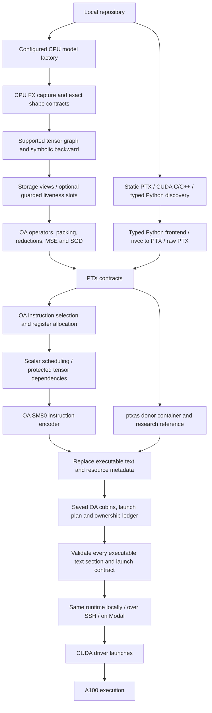

# OpenAssembler architecture and status

Updated **November 12, 2026**. This page describes the current source tree and
latest completed validation. The November 11 native GEMM replay supplies the
current exact policy table; the separate November 7 native NN composition
campaign remains experimental. Full command syntax is in [COMMANDS.md](COMMANDS.md);
every researched feature has a dossier in the [catalogue](research/README.md).
The cross-cutting reverse-engineering record is centralized in the
[reverse-engineering results hub](reverse_eng_results/README.md).

## November 12 native model implementation

The [native model bridge](research/ideas/native-model-bridge.md) now captures a
CPU model factory and emits OA-owned forward/backward, MSE and plain SGD kernels.
The production CLI executes saved OA cubins locally, over SSH or on Modal;
legacy Inductor/Triton capture/replay and vendor kernel fallback are disabled.
Exact shapes and explicit FP32 versus FP16-RNE-operand/FP32-accumulation policies
are guarded. Residual MLP, explicit Tensor Core MLP and attention/FFN graphs pass complete
training checks in separate A100 workers. The attention API adds affine LayerNorm
and 92 full-state fields; four exact cached-decoding buckets pass 12 output/cache
checks. Immutable storage views measure 1.711–1.735× over the OA copy-based
attention inference baseline in two independent A100 workers. Optional guarded
forward/backward buffer reuse reduces attention private allocations from 61
to 32, with bitwise paired complete-state checks. These bounded cases do not
establish general transformer/serving coverage or superiority to NVIDIA;
arithmetic, memory and performance evidence retain their separate scopes.

The [runtime integer-indexing repair](research/ideas/runtime-integer-indexing.md)
adds missing F2I source-register collection protection. Four expanded independent
A100 calls each pass 432 exact checks; all retained 500 GEMM candidate streams
and installed rowwise streams retain their binary/register identities. Original
measurements remain dated evidence; a continuity audit refreshes only current
compiler identities.

The tables and application architecture below describe the November 11 snapshot
and historical Inductor experiments. Current native model behavior is documented
in the linked dossier; those historical gains are not reassigned to OA codegen.

## Headline validation

| Area | Latest completed evidence | Interpretation |
|---|---|---|
| Repository regression | November 12 full suite: 926 passed, two optional Torch modules skipped; separate Torch-enabled CPU graph/numerics cohort: 49 passed | Separate interpreter scopes; later targeted storage-planner checks are also retained under the native model experiment |
| Whole transformer workflow | 10 configurations, two process-order rounds; nine pass both numerical gates | Gains use Inductor/Triton; BF16 training remains excluded |
| Native cooperative reductions | 18 shape/operator cases, five patterns, 17,408,740 output elements pass, plus guards and graph replay; a 58-shape 1/2/4/8-warp A100 sweep and separate seven-case heldout recheck promote five exact rowwise policies | Explicit FP32 operators; selected CTA geometry improves five heldout OpenAssembler cases by at least 3% in all rounds; same-source ptxas remains faster on main shapes |
| Native direct-pointer GEMM | Historical 486 full method/input checks across three runs; six MLP products improve about 1.03–1.12×; current exact selections are audited in the November 11 replay | Direct pointers are selected for measured contracts or explicitly requested; unknown contracts keep legacy pointers. Historical tall regressions remain valid for those tested plans |
| Existing scalar operators | Paired native-before/native-after checks pass for ten cases, with unchanged resources and no observed slowdown | Scheduler correctness fixes do not establish another general speedup |
| BF16 application state | All 127 tensors checked; two parameter tensors fail the unchanged gate | Improved diagnostics, not a numerical repair |
| Repository CLI on Modal | Three native input languages plus an external include; transformer capture emits 67 kernels, replay checks 77 tensors across six optimizer steps with zero new GPU code generation | Shared compile/run/cnr source paths; integration smoke, not new performance estimates |
| Native repository compilation runtime | Bounded parallel source builds are enabled by default; the 26-source repository compile fell from 29.18s serial to 19.62s with four workers, with identical 21-entry/61-kernel outputs ([raw run](../exp/runtime/native-default-20261108.json)) | CPU/toolkit contention can change the best worker count; `OPENASSEMBLER_BUILD_JOBS=1` restores serial behavior |
| Native NN arithmetic campaign | 264/274 initial arithmetic configurations pass; 402/402 tensor checks plus 134 graph checks; six composed NN configurations with full-state gates | Experimental only; rejected gates and slower methods retained |
| Conditional reduction and pointer work | Historical backward FMA reductions improve selected standard-width cases about 1.16–1.31×; early/direct pointer policies now have exact production dispatch evidence | Backward FMA remains experimental; pointer choices are contract-specific. Neither establishes general ptxas superiority |
| Full SM80 control inventory | 42 scalar producer/consumer families plus 14 tensor probes replayed on A100; fixed-pipe minima are mostly S4/S5 and predicate guards S13 | Pair-specific controls; no universal control-field rewrite is admitted |
| CUTLASS-style load-next fragment schedule | Current production-path full gates pass for FP16/BF16 at 1024×4096×1024 and 4096×1024×1024; paired A100 runs are about 8–10% faster than source-order OA | Explicit `--fragment-schedule load_next` only; 24 more registers and held-out large FP16 cases regress; default stays source order |
| Grouped-N CTA traversal | Current production-path full gates pass; repeated 16384×4096×4096 is about 6.9–7.3% faster than m-fast and held-out tall FP16/BF16 cases improve | Explicit `--cta-order grouped_n8` only; wide/square auto-dispatch remains disabled |
| Transformer role/shape coverage | Static audit covers 180 role/dtype rows: 44 direct kernel routes, 84 dimension-fit but blocked by layout or batching, and 52 dimension-contract rejections; QKV/output/FFN role runs pass 462 method/input checks, with corrected pointer and fragment replays retained separately | Initial direct-pointer labels were invalidated and rerun with checked compile contracts. Same-source ptxas remains faster on those medium roles; automatic model routing is separate |
| Current role-matched counters | All 20 counters collected for six FP16 FFN-up methods; OA direct+early executes 4.371M versus ptxas 3.231M total instructions with identical 2.097M tensor work | Extra instructions and overlap both matter; cuBLAS is faster despite more instructions. Counter replay is separate from graph timing |
| Shape-tuned GEMM and copy-address reuse | Completed current production-source selection and independent frozen held-out replay: 42 exact contracts, 500 eligible candidates and 1,500 complete candidate/input checks per session; all binary, numerical, graph and resource gates pass | Automatic dispatch now installs 34 nonbaseline policies and eight measured baseline retentions. Selected policies improve OA baseline by 1.033–2.460× across the paired rounds; copy-address reuse serves 20 contracts and Morton8 the two large tall contracts. Unknown/stale contracts fall back. Same-source ptxas remains faster in all 42 nominal-selected comparisons; this is not a whole-model gain. See [current results](../exp/dispatch_tuning/RESULTS.md) and the [dispatch dossier](research/ideas/shape-aware-native-gemm-dispatch.md) |
| Per-boundary BF16 trajectory | 151/151 checkpoints captured across 30 updates: first observed output failure before update 3; first parameter failure after update 22 | Eager versus Inductor only; unchanged gates and optimizer policy. It does not localize the causal operation or repair native OA composition |

The GEMM campaign keeps A100 variants separate and uses within-worker paired
ratios. Seven held-out nominal selections differ from the pre-frozen installed
policy; their supplemental ptxas/cuBLAS timings refer to the nominal selection,
while promotion evaluates the frozen policy using all-candidate native timing.

These are measured snapshots, not promises for every shape, toolkit, GPU or
training trajectory. Raw device metadata distinguishes A100-SXM4-40GB from
80GB; paired comparisons stay within a device and absolute times are not pooled.

### Repository command workflow

`compile REPO`, `run REPO` and `cnr REPO` now use the same source path and
`--backend local|modal|user@host` transport selection. Directory artifacts
default to `REPO/output/{cubin,sass}`; custom build roots and explicit artifact
directories remain supported. Native remote compilation ships the same compiler
and data, while saved applications retain their matching Python/PyTorch runtime.
`run` never compiles, and source-based selection excludes unrelated builds.
Both stages of `cnr --dry-run` are read-only plans.

See [the workflow guide](REPOSITORY_WORKFLOW.md) for setup/migration and the
[November 7 integration record](evidence/repository-cli-20261107.json) for
native/application runs, runtime identities, numerical gates and source hashes.
Native backend/generator/ISA/optimization identities are recorded in each
dispatch table and tuning record; the legacy/direct encoded-stream checks remain
regression gates while the shape-aware GEMM additions have their own full
source/body/resource tests.
SSH transport has automated coverage; no live SSH GPU destination was supplied
for this update's hardware tests.

## Architecture

Configured Python models and static kernel sources share the OA machine backend.
An explicit `[model]` CPU factory selects graph capture and symbolic autodiff.
Static discovery compiles supported PTX, CUDA C/C++ and typed Python kernels;
independent source discovery does not infer arbitrary host launch logic.
Inductor/Triton application execution and vendor fallback are disabled.

NVIDIA tools still supply the native donor container/reference and CUDA C/C++
parsing to PTX. The compiler does not yet rebuild every cubin ABI feature.
Production execution admits OA-encoded machine text and excludes donor/reference
cubins. PyTorch supplies CPU capture/reference, storage, DMA and stream access.
The conventional custom-autograd adapter can interoperate with external PyTorch
loss/optimizer arithmetic; complete OA ownership requires the native inference
or MSE/backward/SGD entrypoints. Historical Inductor results below retain their
original comparator scope.

### Current module responsibilities

| Location | Responsibility |
|---|---|
| `openassembler/cli.py`, `ui/` | One-shot parser, dispatch, interactive shell and common diagnostics |
| `repository.py`, `project.py`, `build.py` | Static repository/build-system context, source discovery, output naming/locks, manifests, frontend dispatch and compile/package pipeline |
| `pyfront/`, `cppfront.py`, `frontend.py` | Typed Python subset, CUDA C++ lowering and frontend support |
| `ptx/` | PTX parsing and reference semantics for the implemented subset |
| `backend/ra.py` | Native instruction selection, guarded definitions, grouped register allocation, DCE and copy handling |
| `backend/compile.py`, `sched.py`, `unroll.py` | Scalar dependency scoreboards, latency-aware ordering and bounded loop unrolling |
| `backend/tensor.py`, `tensor_encoding.py` | Tensor register groups, async-copy/LDSM/HMMA dependencies and deterministic SM80 tensor encoding |
| `kernels/`, `gemm.py`, `gemm_dispatch.py`, `gemm_tune.py`, `gemm_promotion.py`, `rowwise.py`, `rowwise_dispatch.py` | Validated plans, exact-contract GEMM/rowwise policy selection, optional A100 GEMM tuning, offline promotion auditing, generated PTX and checked launches |
| `opt/divconst.py`, `backend/fragments.py` | Constant integer division/remainder and recorded arithmetic instruction sequences |
| `isa/`, `container/` | Instruction words/fields/templates and CUDA ELF/cubin/metadata handling |
| `emu/` | Functional SASS execution, warp behavior and recorded tensor numeric models |
| `runner.py`, `gpu/` | Buffers/launches, native/reference comparisons, local/SSH/Modal transport and bounded workers |
| `modelfront/` | Constrained CPU graph capture, autodiff, OA kernel recipes, storage planning, reusable native launch runtime and model deployment |
| `native_ownership.py` | Complete executable-text inventory, native instruction identity and artifact admission |
| `torchfront/` | Retained archive/source helpers and historical comparator code; vendor execution entrypoints are disabled |
| `fastmm/` | Explicit low-rank matrix-multiplication research path, not the default GEMM |
| `specs/`, `corpus/`, `probes/`, `tools/` | Encoding data, reference inputs, oracle experiments and maintenance tools |
| `exp/`, `docs/evidence/` | Experiment drivers and immutable measurement records; not production imports |

The older roadmap's general SASS-to-PTX/CUDA lifting and structured decompiler
are research proposals, not additional shipping modules in this tree.

## Features used by the current compiler

| Feature family | Deployment | Contract or boundary |
|---|---|---|
| Python/CUDA C++/PTX native source | Explicit file/repository compilation | Supported kernel language subsets; arbitrary host programs are not compiled |
| Constant div/rem, DCE, copies and register allocation | Native scalar backend | Integer semantics and exact widths/modifiers matter |
| Scalar unrolling/list scheduling | Selected by optimization level | Hardware-measured classes, not a universal latency table |
| Cubin splicing, encoding, disassembly and emulation | Build/inspection/verification paths | SM80 and supported instructions; emulation does not prove timing correctness |
| Dense FP16/BF16 GEMM | `gemm`, or supported tensor PTX | Full-tile `C=A@B.T`, contiguous K, FP32 accumulation/output; exact policy dispatch is shape aware |
| Paired fragment loads, two-stage async copies, shared XOR layout and vector stores | Generated tensor mainloop | 128×128×64 or 64×64×64 CTA tile, 128 threads and 64/32 KiB dynamic shared memory; K is a positive multiple of 128 for the paired loop |
| Shape-aware native GEMM dispatch and optional A100 tuning | `--dispatch auto` (default), `--dispatch manual`, `--autotune local|modal` | Exact compiler/source/contract identity gates; unknown shapes fall back to baseline; tuning validates full outputs and resources before timing |
| Protected tensor scoreboards, address WAR, HMMA8/drain15 and operand reuse | Default tensor backend | Existing measured dependencies are retained across optimization levels |
| Morton8 CTA ordering | Exact automatic FP16/BF16 entries at 16384×4096×4096, or explicit `--cta-order morton8` | Complete 8×8 groups of 128×128 output tiles; no inference to neighboring shapes or physical SM placement |
| CUTLASS-style load-next/compute-current schedule | Explicit `--fragment-schedule load_next` | FP16/BF16 1024×4096×1024 and 4096×1024×1024, stagepair, legacy pointer, late advancement, unfused only |
| Grouped-N CTA traversal | Explicit `--cta-order grouped_n8`; table entry only after a current promotion | N tile count divisible by 8; launch grid remaps to `(m_tiles×8,n_tiles/8)`; current table has no grouped-N rows |
| Transformer role/shape audit | `exp/shape_coverage/` | Role-labelled contract matrix and current forward-role A100 measurements; role labels do not override exact layout/alignment contracts |
| Bias/residual/ReLU epilogue | Explicit `--epilogue` | FP32 auxiliary buffers; selected square benefits, other shapes can regress |
| Pointer-home copy elimination | Exact measured dispatch, optional tuning or explicit `--pointer-mode direct` | Unfused `stagepair`/`m_fast`, either tile family; unsupported or unmeasured automatic contracts keep the reference |
| Early pointer advancement | Exact measured dispatch/tuning or explicit `--pointer-advance early\|auto` | Distinct from the full dispatcher: the explicit placement value `auto` chooses early updates only at 1024×4096×1024 in either tile family; exact measured dispatch may choose early placement on other shapes |
| Copy-address reuse | Exact table/tuner policy or `--tile 64x64 --copy-address-init reuse` | 64-bit derived copy offsets, tile64 only; selected for 20 current exact contracts; no relaxation of address or synchronization checks |
| Cooperative softmax/population LayerNorm | `rowwise --dispatch auto` exact table, `--dispatch manual` reference, or explicit `--warps-per-cta` | Contiguous bounded finite FP32, widths 1–1024, tails; five exact A100 shape/op entries use two/eight warps; all other shapes keep four warps; no affine/saved statistics/backward |
| Scalar alias/WAR/reader/scoreboard repairs and warp synchronization | Scalar backend | Implemented full-mask butterfly shuffle form; unsupported forms fail closed |
| Native Python models | Explicit `[model]` or `--frontend model`/`torch` | Bounded exact-shape CPU graph capture and symbolic derivatives; OA inference/MSE/SGD cubins; unsupported nodes fail |
| Complete state diagnostics | Native model verification and historical comparator gates | All tensors checked, bounded error details, unchanged admission tolerances |
| ReLU/GELU/fused Adam-like examples | Compile the explicit example source | Not automatic model rewrites or a full optimized AdamW implementation |
| AlphaTensor/Strassen factor research | Explicit `fastmm` command | Verified factorizations and bounded experiments; no established default tensor-GEMM win |

The catalogue gives the complete per-idea classification, including validated
but unintegrated work, correct-but-slower experiments, rejected candidates,
source-only hypotheses and hardware-unavailable proposals.

The rowwise CTA table is source-scoped and fails closed on a stale identity or
PTX-body mismatch. It promotes only these heldout A100 contracts: softmax
129×1023→2 warps, 4096×1→8, 4096×32→8; LayerNorm 4096×1→8 and 4096×32→8.
Measured speedups are versus the four-warp OpenAssembler version (about 3.3–12.6%
across the three paired rounds); they are not wins over ptxas or cuDNN. The
LayerNorm 129×1023 and 4096×1024 candidates passed numerical/canary checks but
missed the frozen 3% heldout cutoff and stay on four warps. See the
[shape-aware rowwise dispatch dossier](research/ideas/shape-aware-rowwise-dispatch.md).

## Latest whole-transformer results

The full methods, profiles and raw-record links remain in
[WHOLE_STACK_RESULTS.md](research/WHOLE_STACK_RESULTS.md). These are **ten
synthetic configurations of one decoder-transformer architecture**, not ten
independent pretrained model families. The baseline is eager PyTorch using CUDA
operators/libraries, not stock compiled PyTorch or an exhaustive vendor tuner.
The compiled side is the existing **Inductor/Triton application workflow**.

All rows below are from the original **A100-SXM4-40GB**, CUDA 12.8,
PyTorch 2.7.1+cu128 study. Times are resident-data training steps or prefill;
within-round ratios are eager/compiled, with the process order reversed between
two rounds. Cold compilation, data loading/H2D and model construction are not
included in these steady event medians.

| Workload | Batch / sequence / width / layers | Precision | Eager ms | Compiled frontend ms | Within-round ratio | Gate |
|---|---|---|---:|---:|---:|---|
| Tiny training | 2 / 32 / 64 / 1 | FP32 | 3.513 | 2.841 | 1.20–1.27× | Pass both |
| Base training | 8 / 128 / 128 / 2 | FP32 | 5.796 | 4.032 | 1.35–1.53× | Pass both |
| Long-context training | 2 / 512 / 256 / 2 | FP32 | 5.461 | 3.880 | 1.39–1.42× | Pass both |
| Wide training | 8 / 128 / 512 / 2 | FP32 | 5.800 | 4.380 | 1.24–1.42× | Pass both |
| Deep training | 4 / 128 / 256 / 8 | FP32 | 17.202 | 11.007 | 1.53–1.59× | Pass both |
| Single prefill | 1 / 128 / 256 / 4 | FP32 | 2.004 | 1.171 | 1.68–1.75× | Pass both |
| Long prefill | 8 / 512 / 256 / 4 | FP32 | 4.296 | 3.765 | 1.13–1.15× | Pass both |
| Batched prefill | 16 / 256 / 512 / 2 | FP32 | 5.245 | 4.953 | 1.04–1.08× | Pass both |
| Wide training | 8 / 128 / 512 / 2 | BF16 | 7.235 | 4.778 | **Not admitted** | Fail both |
| Batched prefill | 16 / 256 / 512 / 2 | BF16 | 1.306 | 0.947 | 1.37–1.39× | Pass both |

The nine passing configurations do not establish native OA SASS superiority.
The BF16 row's lower latency cannot override its failed parameter gate. Four
inference models also passed generated-token equality, but decode recomputes a
fixed window at batch one and is not a KV-cache serving benchmark.

### Where application time changed

For base FP32 training, eager/compiled medians were 1.631/1.059 ms for
forward+loss, 2.924/1.842 ms for backward and 1.048/0.953 ms for clipping+optimizer.
Stage medians are not additive. Recognized kernel launches fell from 207 to
123; deep training fell from 615 to 367. Standalone pointwise/reduction work
partly moved into fused groups. The optimizer remained eager/shared.
Compilation/program startup took roughly 14–28 seconds for the short FP32
training invocations, so these runs do not show amortized startup gains.

## Latest native-kernel and integration results

### Native GEMM controls and options

The following six-product/hybrid measurements predate the November 11 dispatch
campaign. Their policy labels and device cohorts describe those original runs;
the current 42-entry policy table and both-session ratios are in the
[current dispatch results](../exp/dispatch_tuning/RESULTS.md).

Same-PTX ptxas beat the original native OA compiler on all six isolated MLP
products: OA was about 41–45% slower. OA beat the selected default GemmEx on two
small shapes, which supports shape/dispatch selection rather than superior OA
scheduling. NCU showed equal tensor instruction counts, zero measured shared
bank conflicts in the contrasted OA/ptxas cases, and more OA address/control
work. It did not prove a specific operand-collector bottleneck.

| Explicit option | Valid measured benefit | Important negative result |
|---|---|---|
| Morton8 | Historical 6.5–7.3% lower time than OA m_fast on 16384×4096×4096; current independent replay promotes that exact FP16/BF16 pair | Still behind matched ptxas; other grids need their own evidence |
| Bias/residual/ReLU | About 5% lower time than separate OA work on tested 4096³ cases | Fused ptxas remains faster; smoke and MLP cases can regress |
| Direct pointer homes | Historical 1.03–1.12× paired median kernel gains on six MLP products; current dispatch selects direct/early combinations only where independently validated | Historical 4096³ neutral and tall regressions prohibit a global pointer-policy change |

Direct-pointer timing is paired within each 40GB/80GB run. In two hybrid MLP
runs, all forward/dX/dW/output/optimizer checks passed bitwise against the legacy
OA and same-PTX controls. The larger MLP's training improves about 1.15–1.31%
and inference 2.97–6.01%; smaller-model training is neutral/slightly slower and
inference slows 2.48–5.22%. The larger cuBLAS whole-state control still fails
its unchanged gradient gate. These are hybrid networks with shared PyTorch
surrounding operations, not complete native transformers.

### Cooperative reductions

Final paired graph medians on the **A100-SXM4-80GB** production replay, in
microseconds per operation. Every graph is poisoned after capture and its
complete output checked after replay.

| Operation / shape | Cooperative OA | Same-PTX ptxas | Previous serial OA | PyTorch CUDA API |
|---|---:|---:|---:|---:|
| Softmax 128×128 | 2.816 | 2.208 | 95.824 | 3.168 |
| Softmax 1024×512 | 3.968 | 2.912 | 306.384 | 4.512 |
| Softmax 1024×1024 | 6.080 | 4.256 | 618.496 | 7.280 |
| LayerNorm 128×128 | 2.240 | 1.792 | 64.624 | 3.520 |
| LayerNorm 1024×512 | 3.808 | 2.816 | 266.816 | 6.304 |
| LayerNorm 1024×1024 | 5.952 | 4.256 | 530.688 | 7.328 |

The large serial-to-cooperative gain is mainly a change in parallel algorithm
mapping. Same-source ptxas remains faster; width-one cases regress about 0.2 µs
versus legacy. These are captured y-only APIs, not full training or tuned-library
claims. Full validation covered 18 shape/operator cases, five input patterns,
17,408,740 candidate outputs and canaries. The ordinary CLI separately passed
2/2 NaN-poisoned analytic/bitwise smoke checks on A100-40GB.

### BF16 and correctness

The unchanged wide BF16 run checks 127 state tensors: outputs, retained clipped
gradients and optimizer tensors pass their configured gates, but two QKV
key-bias parameter tensors fail. The new verifier exposes both failures and
retains the original tolerances. Preserving eager cast rounding was tested and
still failed the layer-zero parameter gate, with no precision-policy promotion.
Changing Adam epsilon is a separate training-policy intervention, not a repair
of the original comparison. No BF16 training speedup is admitted.

## November 7 native NN research round

The [native NN campaign](research/ideas/nn-arithmetic-campaign.md) tests 26
named arithmetic/operator families, 18 FP16/BF16 tensor cases, and six explicit
networks spanning residual MLP, gated MLP and decoder-transformer configurations.
This is native-routed experimental code under `exp/nn_round2/`, separate from
the Inductor application results above. Its composed-network operators remain
experimental and do not automatically enter application graphs.

The first complete 40GB whole-network cohort admits 21 of 36 method/configuration
training pairs after both initial and post-trajectory state checks. GEMM-only
native OA passes all six against ptxas with identical shared surrounding CUDA
operations. Some all-native operator combinations fail training-state gates,
even though isolated outputs pass. Their stored times remain excluded. The
original direct-tanh GELU derivative also fails its unchanged isolated gate;
a [stable analytic derivative](research/ideas/stable-gelu-backward.md) repairs
that contract in a separate candidate.

[Backward FMA reductions](research/ideas/fused-backward-reductions.md) pass 240
initial cases, 16 separate-process selected confirmations and 64 standard-width
cases. At 4096 rows, widths 512/1024 improve about 1.16–1.31× over the earlier OA
forms, while smaller row counts can lose. Same-source ptxas remains faster.
[Earlier GEMM pointer updates](research/ideas/early-gemm-pointer-advance.md)
help one wide shape in FP16/BF16 and regress tall controls in that cohort; the
[joint option search](research/ideas/joint-tensor-options.md) does not justify
an unconditional combination. Backward FMA and whole-network candidates remain
experimental. Pointer placement is now an explicit production option and part
of the exact measured dispatch table; that does not validate the experimental
native operator composition.

A separate A100-80GB [inference packing study](research/ideas/inference-weight-packing-cache.md)
admits 26 method/network pairs, including changed-input graph checks and eager
weight-version invalidation. Cached OA graph inference improves about 2.3–7.6%
over its uncached form; equally cached ptxas is still faster. Captured weights
must stay immutable until recapture. These are within-device ratios, not pooled
40GB/80GB absolute times.

The [counter follow-up](research/ideas/tensor-counter-profiling.md) observes
substantial traversal-dependent DRAM/L2 traffic and remaining OA scoreboard
stalls. FMA candidates execute fewer instructions and allow more active warps;
that supports further register/occupancy work without proving a unique cause.
No whole-native-transformer or general faster-than-CUDA claim is admitted.

## Verification, dependencies and limits

- The retained earlier full local suite is **655 passed, one skipped**. The skip is optional
  PyTorch missing from the compiler-only environment; all 18 numerical tests
  separately pass locally with PyTorch and in the pinned 2.7.1 GPU image. The
  November 11 targeted dispatch/generator/promotion/rowwise suite has **221
  passing tests**. Documentation checking separately validates links, catalogue
  consistency and CLI option coverage; it does not rerun hardware experiments.
- Scalar scheduling repairs pass the paired ten-case native-before/native-after
  hardware regression with bitwise equality and no observed slowdown. Tensor
  default/direct complete-word hashes remain unchanged.
- `compile --verify`, standalone `verify`, `run`, application verification and
  GPU research validation have different scopes. Read [COMMANDS.md](COMMANDS.md)
  and the relevant dossier; a zero-input smoke is not a floating-accuracy proof.
- Compilation needs Python 3.12+ and CUDA tools. GPU execution needs a suitable
  Linux driver locally or an explicitly selected remote/Modal worker. SSH is
  implemented but not part of the latest claimed hardware audit.
- Generated GEMM M/N dimensions fit full 64- or 128-wide tiles, and K is a
  positive multiple of 128, with contiguous-K storage.
  General tails/strides/transposes, TF32 and arbitrary alpha/beta are outside it.
- Row reductions do not provide saved statistics, affine parameters, backward,
  arbitrary layouts, masks or guarantees for NaN/Inf/overflowing finite inputs.
- Captured applications require compatible runtime/cache/bundle metadata and
  matching arguments. They do not compile arbitrary host Python into a binary.
- H100/Blackwell are not validated native backends here. A100 cannot gain
  Hopper TMA, thread-block clusters, DPX or the H100 FP8 Tensor Core path by a flag.

## Research priorities

The November 8 four-iteration follow-up is recorded in
[iteration gap progress](../exp/iteration_rounds/README.md). It promoted source
discovery hygiene, a shape-guarded early pointer-placement policy, and encoder
range checks. The attempted mined-latency scheduler promotion was rejected after
full nvdisasm validation produced invalid SASS on ordinary kernels. The early
pointer candidate remains explicit/shape-specific; no universal ptxas-speed claim
was made. The full A100 gap remains in address work, tensor scheduling,
reductions, and native operator composition correctness.

The catalogue records each experiment's actual status rather than treating a
negative sample as a universal impossibility. Remaining priorities are
counter-guided tensor scheduling, legal joint shared/register-layout search,
expanded held-out shape/tile coverage, transpose/packing integration, normalization backward,
whole-step attention/optimizer boundaries and competitive, precision-matched
low-rank transforms. Timing must retain complete correctness gates and proven
dependency edges.

For exact per-feature methods and reproduction, use the
[research catalogue](research/README.md). For the complete November 6 application
study use [WHOLE_STACK_RESULTS.md](research/WHOLE_STACK_RESULTS.md). Shared setup,
evidence rules and documentation maintenance are in [DEVELOPMENT.md](DEVELOPMENT.md).

