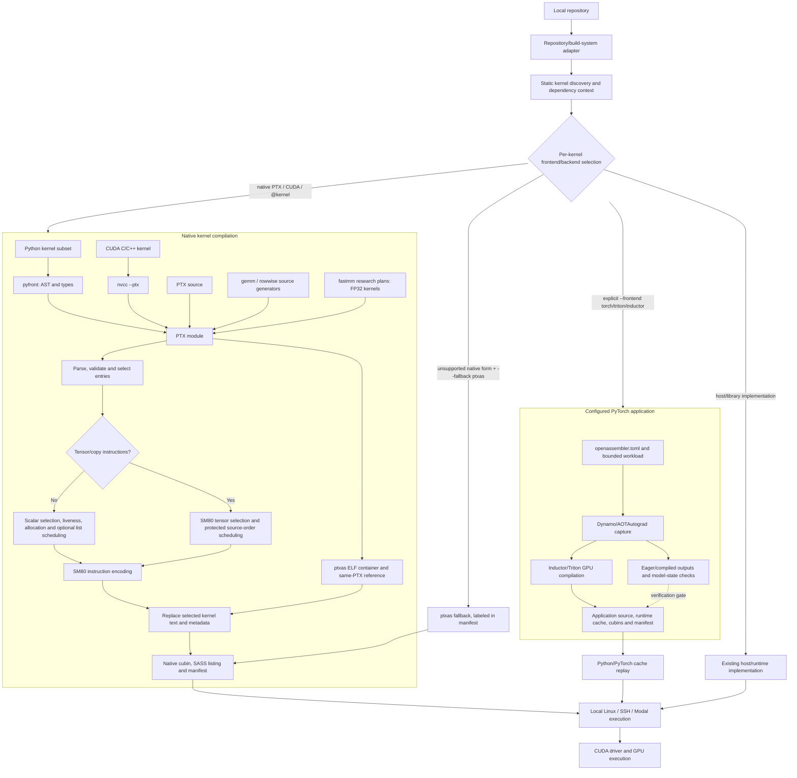

# OpenAssembler architecture and status

Updated **November 7, 2026**. This page describes the current source tree and
latest completed validation. The repository CLI update adds workflow/correctness
checks; the separate November 7 native NN campaign adds GPU measurements and
experimental candidates without promoting them into production. Full command syntax is in [COMMANDS.md](COMMANDS.md);
every researched feature has a dossier in the [catalogue](research/README.md).

## Headline validation

| Area | Latest completed evidence | Interpretation |
|---|---|---|
| Repository regression | 630 passed, one optional PyTorch module skipped; its 18 tests pass separately | Current native/compiler integration checks; not a performance result |
| Whole transformer workflow | 10 configurations, two process-order rounds; nine pass both numerical gates | Gains use Inductor/Triton; BF16 training remains excluded |
| Native cooperative reductions | 18 shape/operator cases, five patterns, 17,408,740 output elements pass, plus guards and graph replay | Explicit FP32 operators; same-source ptxas still faster on main shapes |
| Native direct-pointer GEMM | 486 full method/input checks across three independent runs; six MLP products improve about 1.03–1.12× | Opt-in; tall GEMM regresses and default stays legacy |
| Existing scalar operators | Paired native-before/native-after checks pass for ten cases, with unchanged resources and no observed slowdown | Scheduler correctness fixes do not establish another general speedup |
| BF16 application state | All 127 tensors checked; two parameter tensors fail the unchanged gate | Improved diagnostics, not a numerical repair |
| Repository CLI on Modal | Three native input languages plus an external include; transformer capture emits 67 kernels, replay checks 77 tensors across six optimizer steps with zero new GPU code generation | Shared compile/run/cnr source paths; integration smoke, not new performance estimates |
| Native NN arithmetic campaign | 264/274 initial arithmetic configurations pass; 402/402 tensor checks plus 134 graph checks; six composed NN configurations with full-state gates | Experimental only; rejected gates and slower methods retained |
| New conditional candidates | Backward FMA reductions improve selected standard-width cases about 1.16–1.31×; integrated early pointer placement gains about 1.5–2.3% over direct mode on one wide shape | Smaller/tall cases can regress; neither establishes general ptxas superiority |

These are measured snapshots, not promises for every shape, toolkit, GPU or
training trajectory. Raw device metadata distinguishes A100-SXM4-40GB from
80GB; paired comparisons stay within a device and absolute times are not pooled.

### Repository command workflow

`compile REPO`, `run REPO` and `cnr REPO` now use the same source path and
`--backend local|modal|user@host` transport selection. Directory artifacts
default to `REPO/output/{cubin,sass}`; custom build roots and explicit artifact
directories remain supported. Native remote compilation ships the same compiler
and data, while saved applications retain their matching Python/PyTorch runtime.
`run` never compiles, and source-based selection excludes unrelated builds.
Both stages of `cnr --dry-run` are read-only plans.

See [the workflow guide](REPOSITORY_WORKFLOW.md) for setup/migration and the
[November 7 integration record](evidence/repository-cli-20261107.json) for
native/application runs, runtime identities, numerical gates and source hashes.
Native backend/generator/ISA/optimization files are unchanged; the existing
legacy and direct-pointer encoded-stream hash checks remain regression gates.
SSH transport has automated coverage; no live SSH GPU destination was supplied
for this update's hardware tests.

## Architecture

OpenAssembler has a native-first repository route and an explicit application
route with different code-generation ownership. Static repository discovery
selects PTX, CUDA/C++ and `@kernel` sources for OpenAssembler's SASS backend;
host programs, build systems and launch logic remain context. The configured
application route is selected with `--frontend torch`/`triton`/`inductor` and
owns capture, packaging, replay and checking while Inductor/Triton generates
its GPU code.

NVIDIA's tools remain necessary for the native container/reference and CUDA C++
frontend. The compiler does not rebuild every cubin ABI feature from scratch.
Python orchestrates compilation and host launches; the GPU executes native
instructions. The application route retains Python/PyTorch/ATen and CUDA-library
runtime dependencies. No arrow automatically substitutes native OA GEMMs or
row reductions into Inductor graphs.

### Current module responsibilities

| Location | Responsibility |
|---|---|
| `openassembler/cli.py`, `ui/` | One-shot parser, dispatch, interactive shell and common diagnostics |
| `repository.py`, `project.py`, `build.py` | Static repository/build-system context, source discovery, output naming/locks, manifests, frontend dispatch and compile/package pipeline |
| `pyfront/`, `cppfront.py`, `frontend.py` | Typed Python subset, CUDA C++ lowering and frontend support |
| `ptx/` | PTX parsing and reference semantics for the implemented subset |
| `backend/ra.py` | Native instruction selection, guarded definitions, grouped register allocation, DCE and copy handling |
| `backend/compile.py`, `sched.py`, `unroll.py` | Scalar dependency scoreboards, latency-aware ordering and bounded loop unrolling |
| `backend/tensor.py`, `tensor_encoding.py` | Tensor register groups, async-copy/LDSM/HMMA dependencies and deterministic SM80 tensor encoding |
| `kernels/`, `gemm.py`, `rowwise.py` | Validated shape plans, generated PTX and checked launch contracts |
| `opt/divconst.py`, `backend/fragments.py` | Constant integer division/remainder and recorded arithmetic instruction sequences |
| `isa/`, `container/` | Instruction words/fields/templates and CUDA ELF/cubin/metadata handling |
| `emu/` | Functional SASS execution, warp behavior and recorded tensor numeric models |
| `runner.py`, `gpu/` | Buffers/launches, native/reference comparisons, local/SSH/Modal transport and bounded workers |
| `torchfront/` | Application configuration, capture, source/cache packaging, runtime replay and state verification |
| `fastmm/` | Explicit low-rank matrix-multiplication research path, not the default GEMM |
| `specs/`, `corpus/`, `probes/`, `tools/` | Encoding data, reference inputs, oracle experiments and maintenance tools |
| `exp/`, `docs/evidence/` | Experiment drivers and immutable measurement records; not production imports |

The older roadmap's general SASS-to-PTX/CUDA lifting and structured decompiler
are research proposals, not additional shipping modules in this tree.

## Features used by the current compiler

| Feature family | Deployment | Contract or boundary |
|---|---|---|
| Python/CUDA C++/PTX native source | Explicit file/repository compilation | Supported kernel language subsets; arbitrary host programs are not compiled |
| Constant div/rem, DCE, copies and register allocation | Native scalar backend | Integer semantics and exact widths/modifiers matter |
| Scalar unrolling/list scheduling | Selected by optimization level | Hardware-measured classes, not a universal latency table |
| Cubin splicing, encoding, disassembly and emulation | Build/inspection/verification paths | SM80 and supported instructions; emulation does not prove timing correctness |
| Dense FP16/BF16 GEMM | `gemm`, or supported tensor PTX | Full-tile `C=A@B.T`, contiguous K, FP32 accumulation/output |
| Paired fragment loads, two-stage async copies, shared XOR layout and vector stores | Default generated tensor mainloop | Fixed 128×128×64 CTA tile, 128 threads, 64 KiB dynamic shared memory |
| Protected tensor scoreboards, address WAR, HMMA8/drain15 and operand reuse | Default tensor backend | Existing measured dependencies are retained across optimization levels |
| Morton8 CTA ordering | Explicit `--cta-order morton8` | Complete 8×8 tile groups; measured tall-shape benefit, not automatic dispatch |
| Bias/residual/ReLU epilogue | Explicit `--epilogue` | FP32 auxiliary buffers; selected square benefits, other shapes can regress |
| Pointer-home copy elimination | Explicit `--pointer-mode direct` | Unfused `stagepair`/`m_fast`; preserves legacy default |
| Early pointer advancement | Explicit `--pointer-advance early|auto` | `auto` selects only the measured 1024×4096×1024 shape; tall controls remain late |
| Cooperative softmax/population LayerNorm | Explicit `rowwise` | Contiguous bounded finite FP32, widths 1–1024, tails; no affine/saved statistics/backward |
| Scalar alias/WAR/reader/scoreboard repairs and warp synchronization | Scalar backend | Implemented full-mask butterfly shuffle form; unsupported forms fail closed |
| Application capture/replay | Explicit `--frontend torch`/`triton`/`inductor` on configured PyTorch directories | Pinned supported runtime, captured arguments/shapes, retained runtime dependencies |
| Complete state diagnostics | Application verification gate | All tensors checked, bounded error details, unchanged admission tolerances |
| ReLU/GELU/fused Adam-like examples | Compile the explicit example source | Not automatic model rewrites or a full optimized AdamW implementation |
| AlphaTensor/Strassen factor research | Explicit `fastmm` command | Verified factorizations and bounded experiments; no established default tensor-GEMM win |

The catalogue gives the complete per-idea classification, including validated
but unintegrated work, correct-but-slower experiments, rejected candidates,
source-only hypotheses and hardware-unavailable proposals.

## Latest whole-transformer results

The full methods, profiles and raw-record links remain in
[WHOLE_STACK_RESULTS.md](research/WHOLE_STACK_RESULTS.md). These are **ten
synthetic configurations of one decoder-transformer architecture**, not ten
independent pretrained model families. The baseline is eager PyTorch using CUDA
operators/libraries, not stock compiled PyTorch or an exhaustive vendor tuner.
The compiled side is the existing **Inductor/Triton application workflow**.

All rows below are from the original **A100-SXM4-40GB**, CUDA 12.8,
PyTorch 2.7.1+cu128 study. Times are resident-data training steps or prefill;
within-round ratios are eager/compiled, with the process order reversed between
two rounds. Cold compilation, data loading/H2D and model construction are not
included in these steady event medians.

| Workload | Batch / sequence / width / layers | Precision | Eager ms | Compiled frontend ms | Within-round ratio | Gate |
|---|---|---|---:|---:|---:|---|
| Tiny training | 2 / 32 / 64 / 1 | FP32 | 3.513 | 2.841 | 1.20–1.27× | Pass both |
| Base training | 8 / 128 / 128 / 2 | FP32 | 5.796 | 4.032 | 1.35–1.53× | Pass both |
| Long-context training | 2 / 512 / 256 / 2 | FP32 | 5.461 | 3.880 | 1.39–1.42× | Pass both |
| Wide training | 8 / 128 / 512 / 2 | FP32 | 5.800 | 4.380 | 1.24–1.42× | Pass both |
| Deep training | 4 / 128 / 256 / 8 | FP32 | 17.202 | 11.007 | 1.53–1.59× | Pass both |
| Single prefill | 1 / 128 / 256 / 4 | FP32 | 2.004 | 1.171 | 1.68–1.75× | Pass both |
| Long prefill | 8 / 512 / 256 / 4 | FP32 | 4.296 | 3.765 | 1.13–1.15× | Pass both |
| Batched prefill | 16 / 256 / 512 / 2 | FP32 | 5.245 | 4.953 | 1.04–1.08× | Pass both |
| Wide training | 8 / 128 / 512 / 2 | BF16 | 7.235 | 4.778 | **Not admitted** | Fail both |
| Batched prefill | 16 / 256 / 512 / 2 | BF16 | 1.306 | 0.947 | 1.37–1.39× | Pass both |

The nine passing configurations do not establish native OA SASS superiority.
The BF16 row's lower latency cannot override its failed parameter gate. Four
inference models also passed generated-token equality, but decode recomputes a
fixed window at batch one and is not a KV-cache serving benchmark.

### Where application time changed

For base FP32 training, eager/compiled medians were 1.631/1.059 ms for
forward+loss, 2.924/1.842 ms for backward and 1.048/0.953 ms for clipping+optimizer.
Stage medians are not additive. Recognized kernel launches fell from 207 to
123; deep training fell from 615 to 367. Standalone pointwise/reduction work
partly moved into fused groups. The optimizer remained eager/shared.
Compilation/program startup took roughly 14–28 seconds for the short FP32
training invocations, so these runs do not show amortized startup gains.

## Latest native-kernel and integration results

### Native GEMM controls and options

Same-PTX ptxas beat the original native OA compiler on all six isolated MLP
products: OA was about 41–45% slower. OA beat the selected default GemmEx on two
small shapes, which supports shape/dispatch selection rather than superior OA
scheduling. NCU showed equal tensor instruction counts, zero measured shared
bank conflicts in the contrasted OA/ptxas cases, and more OA address/control
work. It did not prove a specific operand-collector bottleneck.

| Explicit option | Valid measured benefit | Important negative result |
|---|---|---|
| Morton8 | About 6.5–7.3% lower time than OA m_fast on 16384×4096×4096 | Still behind matched ptxas; small/other grids do not justify automatic selection |
| Bias/residual/ReLU | About 5% lower time than separate OA work on tested 4096³ cases | Fused ptxas remains faster; smoke and MLP cases can regress |
| Direct pointer homes | About 1.03–1.12× paired median kernel gains on six MLP products; 486 full checks pass across three runs | 4096³ neutral; tall 16384×4096×4096 regresses; legacy stays default |

Direct-pointer timing is paired within each 40GB/80GB run. In two hybrid MLP
runs, all forward/dX/dW/output/optimizer checks passed bitwise against the legacy
OA and same-PTX controls. The larger MLP's training improves about 1.15–1.31%
and inference 2.97–6.01%; smaller-model training is neutral/slightly slower and
inference slows 2.48–5.22%. The larger cuBLAS whole-state control still fails
its unchanged gradient gate. These are hybrid networks with shared PyTorch
surrounding operations, not complete native transformers.

### Cooperative reductions

Final paired graph medians on the **A100-SXM4-80GB** production replay, in
microseconds per operation. Every graph is poisoned after capture and its
complete output checked after replay.

| Operation / shape | Cooperative OA | Same-PTX ptxas | Previous serial OA | PyTorch CUDA API |
|---|---:|---:|---:|---:|
| Softmax 128×128 | 2.816 | 2.208 | 95.824 | 3.168 |
| Softmax 1024×512 | 3.968 | 2.912 | 306.384 | 4.512 |
| Softmax 1024×1024 | 6.080 | 4.256 | 618.496 | 7.280 |
| LayerNorm 128×128 | 2.240 | 1.792 | 64.624 | 3.520 |
| LayerNorm 1024×512 | 3.808 | 2.816 | 266.816 | 6.304 |
| LayerNorm 1024×1024 | 5.952 | 4.256 | 530.688 | 7.328 |

The large serial-to-cooperative gain is mainly a change in parallel algorithm
mapping. Same-source ptxas remains faster; width-one cases regress about 0.2 µs
versus legacy. These are captured y-only APIs, not full training or tuned-library
claims. Full validation covered 18 shape/operator cases, five input patterns,
17,408,740 candidate outputs and canaries. The ordinary CLI separately passed
2/2 NaN-poisoned analytic/bitwise smoke checks on A100-40GB.

### BF16 and correctness

The unchanged wide BF16 run checks 127 state tensors: outputs, retained clipped
gradients and optimizer tensors pass their configured gates, but two QKV
key-bias parameter tensors fail. The new verifier exposes both failures and
retains the original tolerances. Preserving eager cast rounding was tested and
still failed the layer-zero parameter gate, with no precision-policy promotion.
Changing Adam epsilon is a separate training-policy intervention, not a repair
of the original comparison. No BF16 training speedup is admitted.

## November 7 native NN research round

The [native NN campaign](research/ideas/nn-arithmetic-campaign.md) tests 26
named arithmetic/operator families, 18 FP16/BF16 tensor cases, and six explicit
networks spanning residual MLP, gated MLP and decoder-transformer configurations.
This is native-routed experimental code under `exp/nn_round2/`, separate from
the Inductor application results above. Production compiler behavior is unchanged.

The first complete 40GB whole-network cohort admits 21 of 36 method/configuration
training pairs after both initial and post-trajectory state checks. GEMM-only
native OA passes all six against ptxas with identical shared surrounding CUDA
operations. Some all-native operator combinations fail training-state gates,
even though isolated outputs pass. Their stored times remain excluded. The
original direct-tanh GELU derivative also fails its unchanged isolated gate;
a [stable analytic derivative](research/ideas/stable-gelu-backward.md) repairs
that contract in a separate candidate.

[Backward FMA reductions](research/ideas/fused-backward-reductions.md) pass 240
initial cases, 16 separate-process selected confirmations and 64 standard-width
cases. At 4096 rows, widths 512/1024 improve about 1.16–1.31× over the earlier OA
forms, while smaller row counts can lose. Same-source ptxas remains faster.
[Earlier GEMM pointer updates](research/ideas/early-gemm-pointer-advance.md)
help one wide shape in FP16/BF16 and regress tall controls; the
[joint option search](research/ideas/joint-tensor-options.md) does not justify
an unconditional combination. These are not CLI defaults or new production passes.

A separate A100-80GB [inference packing study](research/ideas/inference-weight-packing-cache.md)
admits 26 method/network pairs, including changed-input graph checks and eager
weight-version invalidation. Cached OA graph inference improves about 2.3–7.6%
over its uncached form; equally cached ptxas is still faster. Captured weights
must stay immutable until recapture. These are within-device ratios, not pooled
40GB/80GB absolute times.

The [counter follow-up](research/ideas/tensor-counter-profiling.md) observes
substantial traversal-dependent DRAM/L2 traffic and remaining OA scoreboard
stalls. FMA candidates execute fewer instructions and allow more active warps;
that supports further register/occupancy work without proving a unique cause.
No whole-native-transformer or general faster-than-CUDA claim is admitted.

## Verification, dependencies and limits

- The latest full local suite is **579 passed, one skipped**. The skip is optional
  PyTorch missing from the compiler-only environment; all 18 numerical tests
  separately pass locally with PyTorch and in the pinned 2.7.1 GPU image.
- Scalar scheduling repairs pass the paired ten-case native-before/native-after
  hardware regression with bitwise equality and no observed slowdown. Tensor
  default/direct complete-word hashes remain unchanged.
- `compile --verify`, standalone `verify`, `run`, application verification and
  GPU research validation have different scopes. Read [COMMANDS.md](COMMANDS.md)
  and the relevant dossier; a zero-input smoke is not a floating-accuracy proof.
- Compilation needs Python 3.12+ and CUDA tools. GPU execution needs a suitable
  Linux driver locally or an explicitly selected remote/Modal worker. SSH is
  implemented but not part of the latest claimed hardware audit.
- Generated GEMM dimensions are multiples of 128 with contiguous-K storage.
  General tails/strides/transposes, TF32 and arbitrary alpha/beta are outside it.
- Row reductions do not provide saved statistics, affine parameters, backward,
  arbitrary layouts, masks or guarantees for NaN/Inf/overflowing finite inputs.
- Captured applications require compatible runtime/cache/bundle metadata and
  matching arguments. They do not compile arbitrary host Python into a binary.
- H100/Blackwell are not validated native backends here. A100 cannot gain
  Hopper TMA, thread-block clusters, DPX or the H100 FP8 Tensor Core path by a flag.

## Research priorities

The November 8 four-iteration follow-up is recorded in
[iteration gap progress](../exp/iteration_rounds/README.md). It promoted source
discovery hygiene, a shape-guarded early pointer-placement policy, and encoder
range checks. The attempted mined-latency scheduler promotion was rejected after
full nvdisasm validation produced invalid SASS on ordinary kernels. The early
pointer candidate remains explicit/shape-specific; no universal ptxas-speed claim
was made. The full A100 gap remains in address work, tensor scheduling,
reductions, and native operator composition correctness.

The catalogue records each experiment's actual status rather than treating a
negative sample as a universal impossibility. Remaining priorities are
counter-guided tensor scheduling, legal joint shared/register-layout search,
small-grid tile selection, transpose/packing integration, normalization backward,
whole-step attention/optimizer boundaries and competitive, precision-matched
low-rank transforms. Timing must retain complete correctness gates and proven
dependency edges.

For exact per-feature methods and reproduction, use the
[research catalogue](research/README.md). For the complete November 6 application
study use [WHOLE_STACK_RESULTS.md](research/WHOLE_STACK_RESULTS.md). Shared setup,
evidence rules and documentation maintenance are in [DEVELOPMENT.md](DEVELOPMENT.md).

