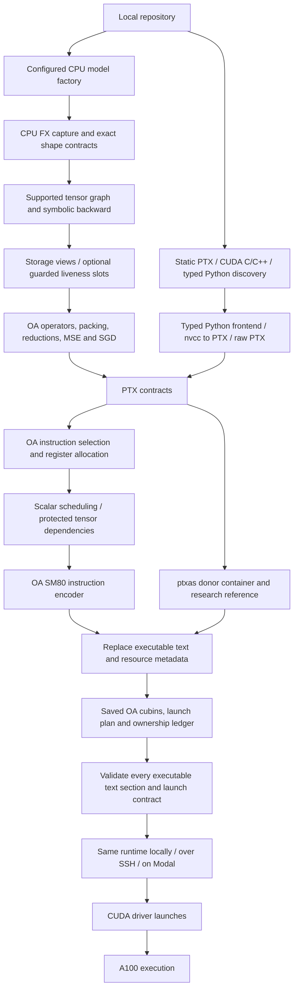

# OpenAssembler architecture and status

## November 26 practical CNN compilation

[FP32 Conv2d](compiler/gaps-convolution.md) now supports NCHW/OIHW tensors,
optional bias, groups=1 and static stride/padding/dilation. Capture, native
forward, input/weight/bias gradients and SGD training/replay work through the
normal model route. The [CNN example](../examples/native_cnn/model.py) combines
two convolutions, ReLU, sigmoid, spatial mean and a linear head.

Independent validation passes 144 complete offline tensor executions, 21 focused
tests and 645 model regressions. A100 passes 80 full-tensor comparisons and ten
profiler ownership checks. Public CLI compile and saved replay each pass 45
training-state checks over three updates. The audit regenerates 142 exact native
outputs across eleven bundles. [Validation](../compiler_exp/gap_closure/conv2d/validation.json)
retains the hardware/archive/source identities. Grouped/depthwise convolution,
pooling, BatchNorm, dynamic shapes and broader dtypes remain open.

## November 26 Boolean array, buffer and shared storage

[Boolean storage](compiler/gaps-boolean-storage.md) now maps logical predicates to
one-byte global/shared elements, nonzero load decoding and canonical stores.
Raw arrays and rank 1..4 checked Buffer views preserve exact byte spans/strides,
false out-of-bounds loads, skipped stores and source/native ownership. Public
Boolean buffers require true/false initialization and reject wrong numeric roles.

Independent original-source gates pass **5,280 A100 launches** and **528 actual
public buffer launches**, auditing **22,302,720 complete bytes** and **264 exact
native outputs**. All **208 focused tests** and **12,672 independent offline
executions** pass. Eight exact stale type rejection cases are updated without
changing numerical references. Full suites pass **5,136 supported tests** and **4,651 compiler-only tests with
fifteen skips**. All **4,214 preceding native outputs** remain exact. The 49
measured policies/98 retained sessions, installed 132 identities/264 native outputs,
public remote publication and docs pass. The
[validation record](../compiler_exp/gap_closure/python_boolean_abi/storage/validation.json)
binds exact final sources and evidence. The complete 51-gap program remains incomplete; direct predicate comparisons and broader Python,
memory safety, ABI and performance milestones remain separate work.

## November 25 logical Boolean kernel parameters

[Boolean kernel parameters](compiler/gaps-boolean-parameters.md) now carry a
logical predicate over the validated physical byte slot. Source type metadata,
canonical typed verification, normal build/manifest/native ownership and public
Boolean JSON bindings preserve the exact role. Integer/buffer/raw-byte host keys
cannot silently become Boolean parameters; Boolean dimension names remain Boolean.
Array/Buffer/shared Boolean storage remains separate work.

The original-source gate passes **9,600 A100 launches** plus **960 actual public
Boolean run-spec launches**, with **69,746,688 independently checked complete
bytes** and **240 exact native outputs**. All **164 new regressions** pass. Two
existing rejection fixtures now exercise unsupported Boolean array annotations
because scalar annotation rejection became stale. All 49 measured policies and
98 sessions retain exact binaries/controls/resources before identity rebinding.
Fresh replay reproduces all **3,974 prior native outputs** exactly. Full suites
pass **4,928 supported tests** and **4,443 compiler-only tests with fifteen skips**.
Installed wheel/public remote builds and live/exported docs pass; the
[validation record](../compiler_exp/gap_closure/python_boolean_abi/scalar/validation.json)
binds final sources and evidence. The next [Boolean storage study](compiler/gaps-boolean-storage.md)
retains original Array/Buffer/shared rejections and required storage semantics.
The full 51-gap program remains incomplete.

## November 25 narrow scalar entry parameters

[Narrow entry ABI](compiler/gaps-narrow-parameters.md) now admits b/u/s8/16
scalar slots, exact natural byte layout, signed/zero extension and within-slot
partial reads. Parser, both selectors, interpreter, verifier, explicit-run schema
and batch-driver arguments share the physical contract. Aggregate/vector/device
call slots and logical Python Boolean launch/storage remain separate work.

The independent original-source gate passes **14,400 A100 launches** and **240
actual explicit-run launches**, auditing **67,461,120 complete bytes** and **240
exact current native outputs**. All **171 new regressions** pass; existing tests
remain unchanged. All 49 measured policy binaries and 98 sessions remain exact
before source identity rebinding; public Modal publication preserves original
signatures/native ownership. A fresh replay passes **3,734 direct prior-native
comparisons**, every word/control/register exact. Full suites pass **4,764 supported
tests** and **4,279 compiler-only tests with fifteen skips**. Wheel checks preserve
132 installed identities and 240 native outputs; live/exported docs pass. The
[validation record](../compiler_exp/gap_closure/narrow_parameters/validation.json)
binds final sources and evidence. The next [original CUDA scalar study](compiler/gaps-narrow-scalars.md)
records the now-reached setp.s16 boundary without claiming those operations supported.
The full 51-gap program remains incomplete, with no speed claim.

## November 24 logical Boolean helper signatures

[Pure Boolean helpers](compiler/gaps-boolean-helpers.md) now accept and return
logical predicates through existing static expansion, exact argument copies,
complete return paths and source/native ownership. The independent original-source
gate passes **2,400 A100 launches**, **16,220,160 complete bytes** and **240 exact
current native outputs**. All **155 new regressions** pass; existing tests remain
unchanged. Full suites pass **4,593 supported tests** and **4,108 compiler-only
tests with fifteen skips**. The installed wheel checks 132 identities and 240
original source/native regenerations; live and isolated-export documentation
checks pass. The
[validation record](../compiler_exp/gap_closure/python_boolean_abi/helpers/validation.json)
binds final source, evidence and log identities.

The preceding Boolean-value corpus freshly regenerates **240 exact PTX/native
outputs**; **3,254 earlier exact comparisons** retain their proof/archive and
unchanged executable/backend identities. Twenty source files retain 62 accepted
kernels and unchanged rejected diagnostics. Public Modal publication keeps the
predicate signatures; all measured-policy compiler inputs remain exact. The
[physical ABI study](compiler/gaps-boolean-abi.md) remains open. The full 51-gap
program remains incomplete, without a speed claim.

## November 24 Boolean values and native predicate paths

[Boolean values](compiler/gaps-boolean-values.md) now preserve operand-returning
lazy and/or, exact numeric literal contexts, Boolean locals/literals/not/bool,
chain values and typed integer conversion. Original value kind/location/digest/
use records join source/native ownership. Boolean ABI, mixed-type unions, dynamic
steps and unrestricted Python effects remain open.

The first A100 gate found 54 real loop-carried predicate failures at mined/sched/
opt. A native control-flow predecessor repair enforces the existing predicate
readiness rule across backward/alternate edges. The final original-source gate
passes **2,400 launches**, **16,957,440 complete independent bytes** and **240 exact
current native outputs**. A separate transition audit proves unchanged sources/
PTX/inputs/references and only stall/yield changes in twelve outputs. All **167
new regressions / 1,246 focused tests** pass; public Modal publication works.
All 49 measured policy binaries and 98 sessions remain exact before source
identity rebinding. A fresh replay passes **3,254 prior native comparisons, all
exact**; no inherited-only executable shortcut is used. Full suites pass **4,438
supported tests** and **3,953 compiler-only tests with fifteen skips**. The wheel
checks 132 identities and 240 native regenerations. The
[integration record](../compiler_exp/gap_closure/python_boolean_values/promotion/validation.json)
binds final sources, proofs and documentation. The next [Boolean ABI study](compiler/gaps-boolean-abi.md)
records its actual unsupported byte-parameter boundary. The complete 51-gap program
remains incomplete, with no speed claim.

## November 24 typed condition comparison chains

[Condition chains](compiler/gaps-comparison-chains.md) now preserve single
middle-operand evaluation, short-circuit memory/atomic effects and pairwise exact
literal typing. Existing numeric kinds, FP32 special-value/negation semantics,
helper/caller isolation and convergence rules remain explicit. Original expression
locations, AST digests and per-kernel counts join source/native ownership, including
standalone kernels without helper/static-value metadata. First-class Boolean
values, dynamic range steps and general Python effects remain open.

The final original-source gate passes **2,400 A100 launches**, **15,482,880 complete
independent bytes** and **240 exact native outputs**. The offline gate passes
4,320 executions, generated controls add 128 chains / 1,536 executions, and all
**159 new tests** pass. The earlier prototype and first numerically passed payload
remain distinct from the final standalone-source ownership repair. Full suites
pass **4,271 supported tests** and **3,786 compiler-only tests with fifteen skips**.
All 1,079 frontend tests pass. Installed-wheel and public Modal checks preserve
source/native ownership. 240 preceding range/else outputs regenerate exactly;
2,774 earlier occurrences retain their proof/archive and unchanged backend-input
binding. The [integration record](../compiler_exp/gap_closure/python_comparison_chains/promotion/validation.json)
binds final source and evidence identities. The next [Boolean-value experiment](compiler/gaps-boolean-values.md)
remains outside production. The full 51-gap program remains incomplete, with no
performance claim.

## November 24 finite range counters and loop else

[Runtime loop control](compiler/gaps-range-control.md#original-source-production-extension)
now exhausts finite i32 ranges before a nonunit counter can wrap and preserves
range/while else with nearest-loop break/continue and helper/kernel returns.
Bounds remain snapshotted; visible target mutation, empty loops, live-path
initialization, convergence checks and original source/native ownership remain
explicit. Dynamic steps, wider bounds and arbitrary Python control/effects remain open.

The final original-source gate passes **2,400 A100 launches**, **17,203,200 complete
independent bytes** and **240 exact native outputs**. The offline matrix passes
4,320 executions; generated controls add 128 cases / 1,536 executions. All
**150 new tests / 920 frontend tests** and public CLI/Modal publication pass.
240 preceding helper-return outputs regenerate exactly; 2,534 earlier occurrences
retain their proof/archive hashes and unchanged backend input binding. An O0/O3
minimized hardware study isolates the external optimizer disagreement; all raw
failed and successful observations remain retained. Full suites pass **4,112
supported tests** and **3,627 compiler-only tests with fifteen skips**. The
installed wheel checks 132 exact identities and 240 native regenerations. The
[integration record](../compiler_exp/gap_closure/python_range_control/promotion/validation.json)
binds final sources, proofs and documentation. Comparison chains remain an
[isolated experiment](compiler/gaps-comparison-chains.md). The complete 51-gap
program remains incomplete.

## November 24 pure scalar helper return paths

[Helper returns](compiler/gaps-helper-returns.md) now preserve original branch,
loop and nested returns with typed return homes, caller snapshots, live-path
initialization and exact original source/native ownership. Missing/bare/type/
effect/initialization rejection controls stay active; runtime range/while else,
arbitrary iterables, native aggregate ABI and general Python effects remain open.

The final source-exact gate passes **2,400 A100 launches**, **16,465,920 complete
independent bytes** and **240 exact native outputs**. The offline matrix passes
4,320 complete executions; generated controls add 64 original combinations /
768 executions. All **156 new tests / 425 focused regressions** and public
CLI/Modal publication pass. Eighteen previous source files retain 62 exact PTX
kernels; 240 prior tuple outputs newly regenerate exactly, and 2,294 earlier
replay results retain their hashes and unchanged backend inputs. Full suites pass
**3,962 supported tests** and **3,477 compiler-only tests with fifteen skips**.
The installed wheel checks 132 identities and 240 native regenerations; the
[integration record](../compiler_exp/gap_closure/python_helper_returns/promotion/validation.json)
binds final source and proof identities. The next [range-counter study](compiler/gaps-range-control.md)
remains experimental. The complete 51-gap program remains incomplete, with no speed claim.

## November 24 finite static tuple iteration

[Static tuple loops](compiler/gaps-static-loops.md) now preserve empty loops,
selected/modified/post-loop targets, thread-dependent break/continue, nested
tuple/range control and exhaustion else. A runtime counter/value-selection body
retains original source/type/convergence and loop-value/native ownership. Runtime
containers, arbitrary iterables, early helper returns and general Python control
or host effects remain open.

The original-source A100 gate passes **2,400 launches**, **16,465,920 audited
bytes** and **240 exact native outputs**. The independent offline gate passes
4,320 complete executions and twenty negative controls. All **150 focused tests**
pass. The installed wheel regenerates all source/native outputs, and actual public
CLI/Modal publication works. Eighteen earlier Python files retain 62 identical
kernels and rejection results; all 49 measured policies retain original code
across 98 sessions. The [experiment](../compiler_exp/gap_closure/python_static_loops/promotion/README.md)
retains candidate type/fixture/harness failures and the reviewed repair. The
full supported suite passes **3,806 tests**, and the compiler-only suite passes
**3,321 tests with fifteen skips**. All **2,294 earlier native occurrences** retain
exact words/registers. The [integration record](../compiler_exp/gap_closure/python_static_loops/promotion/validation.json)
binds final source and evidence identities. The 51-gap program remains incomplete,
with no new performance claim.

## November 24 original-source static numeric and tuple values

[Explicit static values](compiler/gaps-static-values.md) now specialize Final
numeric/immutable tuple declarations in the original source graph. Bounded
arithmetic, tuple indices/slices/len, imports and per-kernel helper specialization
preserve exact source/value/diagnostic/dependency/native ownership. Mutable
captures, runtime containers, arbitrary metaprogramming and host effects remain
open. No user source module is executed during compilation.

The final original-source gate passes **1,440 A100 launches**, with **9,338,880
complete audited bytes** and **144 exact native outputs**. The independent
functional gate passes 2,592 executions; 2,048 generated integer trees and 29
negative controls pass. All **118 focused tests** pass. The installed wheel
recreates original-source PTX/native code, and public CLI/Modal publication works.
The [experiment](../compiler_exp/gap_closure/python_static_values/promotion/README.md)
retains the prototype rebinding counterexample, first successful hardware payload,
focused-reference failure and corrected final source evidence. Full suites pass
**3,656 supported tests** and **3,171 compiler-only tests with fifteen skips**.
All **2,150 earlier native kernel occurrences** retain exact words/registers.
The [integration record](../compiler_exp/gap_closure/python_static_values/promotion/validation.json)
binds final sources, suites, independent numerical/native/ownership proof, retained
failures and documentation. The complete 51-gap program remains open; no speed
claim is made.

## November 24 static local-package Python device helpers

[Local-package helpers](compiler/gaps-python.md#static-local-package-device-helpers)
now retain their defining module's scalar types and original diagnostics through
direct/module aliases, relative imports and static re-exports. Exact entry/helper/
package hashes and helper signatures/bodies/call sites flow through PTX, manifests
and native ownership. `--python-source-root` selects explicit local resolution;
normal local/Modal/SSH builds share the frontend. Runtime imports, arbitrary
packages, mutable captures and host application effects remain open.

The final gate passes **600 original-source A100 launches**, **5,529,600 audited
bytes** and **60 exact native outputs**, including CLI directory/explicit-root and
serialized worker builds. The installed wheel regenerates all source trees and
native outputs, and actual public CLI/Modal publication passes. All **73 focused
tests**, **2,090 earlier native kernel occurrences**, and 49 measured policies
across 98 original sessions pass their distinct gates. The
[experiment](../compiler_exp/gap_closure/python_module_helpers/promotion/README.md)
retains initial full-suite frontend-routing failures and the validated repair.
The reruns pass **3,538 supported tests** and **3,053 compiler-only tests with
fifteen skips**. The [integration record](../compiler_exp/gap_closure/python_module_helpers/promotion/validation.json)
binds final sources, numerical/native proofs, failed runs and documentation.
Existing generation code remains structurally identical outside separately
validated entry adapters. The complete 51-gap program remains unfinished;
no speed claim is made.

## November 24 low64 multiplication in PTX/CUDA and typed Python

[Low64 products](compiler/gaps-wide.md#low-64-bit-integer-multiplication) now
compile through PTX/CUDA `mul.lo.u64/s64` and Python `i64/u64` `*`/`*=`. Four
recovered IMAD/IMAD.HI words retain exact modulo-2^64 results through aliases,
guards, literals/parameters, helpers/loops/casts and register/parameter squares.
The backend and Python frontend were validated together before exact promotion.
Wide/high products, FP64 arithmetic and division/remainder remain open.

The two original-source A100 gates pass **1,560 launches**. Their production
audits check **15,974,400 complete bytes** and **156 exact native comparisons**.
All **140 focused tests** pass; the isolated wheel regenerates Python PTX and
matches all 156 native outputs. Fifteen earlier Python files retain 62 identical
kernels and unchanged rejections. All 49 measured policies retain exact native
code across 98 original sessions. The
[experiment record](../compiler_exp/gap_closure/wide_multiply/promotion/README.md)
keeps base/square hardware gates and failures separate. Both full suites pass:
**3,465 supported tests**, and **2,980 compiler-only tests with fifteen skips**.
All **1,934 earlier native kernel occurrences** retain exact executable code.
The [integration record](../compiler_exp/gap_closure/wide_multiply/promotion/validation.json)
binds final sources, suites, native/byte proofs, retained failures and docs. The
original 51-gap program remains incomplete; no speed claim is made.

## November 24 exact scalar 64-bit selection

[Wide selection](compiler/gaps-wide.md#scalar-64-bit-conditional-selection) now
admits `selp.b64/u64/s64/f64` using two recovered scalar SEL words. Both halves
preserve exact bits through aliases, outer guards, negated predicates,
parameters and immediates. The actual CUDA noinline workload that exposed the
rejection now builds and executes through the normal frontend and owned backend.
FP64 arithmetic and general G11 coverage remain open.

The original-source A100 gate passes **1,480 launches**; the production audit
checks **15,155,200 complete bytes** and **148 exact native comparisons**.
All **87 focused tests**, **3,361 supported tests**, and **2,876 compiler-only
tests with fifteen skips** pass. The installed wheel reproduces all 148 native
outputs. All 49 measured policies retain exact original code across 98 sessions.
The [experiment](../compiler_exp/gap_closure/wide_select/README.md) keeps initial
invalid FP64 sources, corrected legal controls, diagnostic failures and current
integration gates separate. All **1,786 earlier native kernel occurrences**
match exactly. The [integration record](../compiler_exp/gap_closure/wide_select/validation.json)
binds the final source, suites, failure evidence and documentation. The original
51-gap program remains incomplete; no speed claim is made.

## November 24 explicit scalar device source libraries

[PTX/CUDA source libraries](compiler/gaps-device-functions.md#explicit-ptx-and-cuda-source-libraries)
now resolve through normal `--device-library` CLI and remote builds. Private,
exported/weak and scalar signature rules are deterministic; each CUDA unit keeps
its compile flags and before/after dependency hashes. Ownership records the
complete link contract. Binary object/archive linking, native call stacks and
general host build/link orchestration remain open.

The final original-linked-control gate passes **576 A100 launches**, including
wide slots, local frames, transitive/private helpers, per-unit databases and a
serialized remote worker. The production audit checks **4,128,768 retained
bytes** and **48 exact native comparisons**. Full suites pass **3,274 supported
tests** and **2,789 compiler-only tests with fifteen skips**. An isolated wheel
and an ordinary Modal CLI/publication check pass. All 49 measured policies keep
their original native code. The [integration record](../compiler_exp/gap_closure/device_linkage/promotion/validation.json)
retains source, failure and prior-native evidence. All **1,738 earlier native
kernel occurrences** retain exact executable code. The original 51-gap program
remains incomplete; no speed claim is made.

## November 24 direct scalar device functions

[Direct scalar PTX functions](compiler/gaps-device-functions.md) now resolve
through static specialization before normal code generation. Lexical slots,
argument snapshots, nested/guarded/early returns and per-call local objects
preserve their admitted semantics. Kernel manifests and ownership bind the
function signatures, body hashes and expanded call counts. Native stacks,
recursive/indirect calls, aggregate/register ABI and cross-module linking
remain open.

The final gate passes **960 A100 launches**, including an ordinary CUDA
`__noinline__` source build. The production audit checks **6,881,280 retained
bytes** and sixty exact native comparisons. An isolated wheel passes all sixty
comparisons, and all 49 measured policies retain their original code. The
[integration record](../compiler_exp/gap_closure/device_functions/validation.json)
keeps full suites and earlier-application continuity separate from new hardware
execution. Both full suites pass: **3,229 supported tests** and **2,744 compiler-only tests
with fifteen skips**. All **1,678 earlier native occurrences** retain
exact code. No performance claim is made; the original 51-gap program remains
incomplete.

## November 24 typed shared arrays and CTA convergence

[Python i64/u64 shared arrays](compiler/gaps-python-types.md#wide-shared-arrays-and-native-cta-reconvergence)
now use natural eight-byte alignment/scaling and count mixed-layout padding
against the existing 48 KiB limit. The initial A100 gate exposed missing native
convergence before a CTA barrier. Failed scoreboard/layout ablations remain
retained; a proven forward-phase BSSY/BSYNC pass repairs the tested dependency.
Cyclic/irreducible control flow and general shared-memory safety remain open.

The final gate passes **1,280 A100 launches**. The production audit checks
**20,971,520 retained bytes** and eighty exact native comparisons. Full suites
pass **3,176 supported tests** and **2,691 compiler-only tests with fifteen
skips**. All 49 measured policies keep their original native code; 62 existing
Python kernels retain byte-identical PTX. All **1,598 earlier native kernel
occurrences** also retain exact executable code. The
[integration record](../compiler_exp/gap_closure/python_shared_wide/validation.json)
binds exact source, wheel and prior-native evidence. There is no performance
claim; the original 51-gap program remains incomplete.

## November 23 scalar shared-memory widths

[Scalar shared byte/halfword/64-bit loads and stores](compiler/gaps-memory.md#scalar-shared-byte-halfword-and-64-bit-memory)
now preserve signed extension, raw wide bits, false-load values and neighboring
bytes. Four narrow-store templates are recovered from actual oracle words and
12,096 varied disassemblies. An initial 64-bit exchange failed optimized A100
execution; retaining the validated six-cycle barrier issue gap repairs the
observed dependency. Failed runs and exact candidate snapshots remain retained.

The final gate passes **1,216 A100 launches**. A production audit checks
**34,865,152 retained bytes** and 76 exact native comparisons; an isolated wheel
check verifies the same executable output and packaged template data. Full
[integration evidence](../compiler_exp/gap_closure/shared_widths/validation.json)
keeps suites and prior policy/application continuity separate from new hardware
execution. Both full suites pass: **3,099 supported tests** and **2,614 compiler-only
tests with 15 explicit skips**. All 49 measured policies and 1,522 earlier
application kernel occurrences retain their exact native code. Dynamic shared alignment, initialization/races, wider vector/order
contracts and the original 51-gap program remain open. No speed claim is made.

## November 23 typed constant expressions

[Typed scalar operand expressions](compiler/gaps-wide.md#typed-scalar-operand-constant-expressions)
now support integer precedence/casts/arithmetic and per-operation binary64
floating evaluation, with explicit type and depth diagnostics. The final A100
gate passes **384 launches** and the audit checks **40,304,640 retained bytes**
and 24 native comparisons. The initial failed hardware gate remains retained;
remainder signedness, mixed conditional types and invalid generated-NaN cases
have explicit unresolved boundaries. General expressions across declarations,
addresses and broader PTX remain open. No speed claim is made.

The [current integration](../compiler_exp/gap_closure/constant_expressions/validation.json)
passes **3,042 supported tests** and **2,557 compiler-only tests with 15 explicit
skips**. All 49 measured policies retain their native bytes. The original
51-gap program remains incomplete.

## November 23 decimal and raw floating literals

[Typed literal normalization](compiler/gaps-wide.md#decimal-and-raw-floating-literal-contexts)
now parses decimal/exponent values as binary64 before scalar use conversion.
It preserves signed zero and observed raw payload/width rules and rejects
invalid contexts. Independent rational/context controls, 360 complete PTX/SASS
executions and **320 A100 launches** precede production promotion. The audit
checks **28,737,536 retained bytes** and twenty native comparisons. General
floating expressions, wider arithmetic/types/modifiers and full operand
conformance remain open; no speed claim is made.

The [current integration](../compiler_exp/gap_closure/float_literals/validation.json)
passes **2,974 supported tests** and **2,489 compiler-only tests with 15 explicit
skips**. All 49 measured policies and 1,478 earlier native occurrences retain
exact code. The original 51-gap program remains incomplete.

## November 23 virtual pressure scheduling

[Pressure-aware scheduling](compiler/gaps-spilling.md#pressure-aware-virtual-scheduling)
now compares virtual instruction order before allocation for spilled scalar
kernels. Dependency/guard/load-order and fixed control/memory boundaries are
preserved. An alternative must reduce spill slots without increasing the
frame or any block's local transfers. Successful no-spill and equal-resource
plans keep the existing path. The specialized tensor allocator remains separate.

A100 records pass **2,144 correctness launches** and **1,323 timed launches**,
plus 189 checked warmups, over frozen OA/current OA/same-PTX controls and final
source admission. Six new workloads eliminate spills; another recovers a
valid maximum local frame that previously rejected. Paired resident kernel
medians improve on the new controls while ptxas remains faster in nominal
comparisons. Host code-generation cost increases, including an unchanged
legacy kernel; no whole-application or compile-amortized speedup is claimed.
Slot reuse, tensor-fragment spilling and general occupancy policy remain open.

The [current integration](../compiler_exp/gap_closure/pressure_schedule/validation.json)
passes **2,927 supported tests** and **2,442 compiler-only tests with 15 explicit
skips**. All 49 measured policies and 1,386 earlier native kernel occurrences
retain exact code. G17 and the original 51-gap program remain partial beyond
the explicitly validated contracts.

## November 23 aligned-group and predicate spilling

[Bounded spilling](compiler/gaps-spilling.md) now covers entire aligned
pairs/quads and predicates. Another **320 A100 launches** pass at all four
compiler levels, including automatic pressure, tight register limits,
self-guarded/negated predicate loops and declared-local coexistence. An
independent audit checks **83,787,776 complete retained bytes**, twenty native
binaries and exact driver frame/register resources. The successful prior
scalar policy remains unchanged. Slot reuse and general pressure/occupancy
selection remain open; the original 51-gap program remains incomplete.

The [current integration](../compiler_exp/gap_closure/spilling_groups/validation.json)
passes **2,898 supported tests** and **2,413 compiler-only tests with 15 explicit
skips**. All 49 measured policies and 1,366 earlier native kernel occurrences
retain their executable bytes. Specialized tensor-fragment spilling remains
a separate dependency/resource contract.

## November 23 bounded scalar spilling

[Scalar spill allocation](compiler/gaps-spilling.md) now recovers ordinary
register exhaustion and honors explicit register limits through private local
slots. A100 gates pass **384 launches** covering 16/32/64/252-register domains,
guarded loop updates and coexistence with declared local objects. Driver frame
and register resources match generated metadata. The subsequent extension above
adds grouped/predicate spills; general pressure policy remains open.

The [latest integration](../compiler_exp/gap_closure/spilling/validation.json)
passes **2,883 supported tests** and **2,398 compiler-only tests with 15 explicit
skips**. All 49 measured policies and 1,342 earlier native kernel occurrences
retain their executable bytes. A separate randomized resident pressure-kernel
comparison shows the 64-register OA variant slower than its 252-register control;
no new automatic register policy or whole-application speedup is claimed.

## November 23 static local storage

[Native local frames](compiler/gaps-storage.md) now support static per-thread
storage, explicit 32-bit local addresses and scalar32 load/store, with natural
alignment and a 65,536-byte frame bound. OA patches its own per-function frame
metadata after donor optimization and binds that reservation in native ownership.
The final A100 gate passes **704 launches**, complete private-state/guard/tail
checks and matching driver resources across 48/64/80/65,536-byte layouts.
All 49 measured policies and 1,298 earlier application kernel occurrences retain
their native code. Generic module storage, wider local transfers and device
calls remain open; the subsequent spilling extensions above use this storage.

The [latest integration](../compiler_exp/gap_closure/local_storage/validation.json)
passes **2,868 supported-environment tests**, plus **2,383 compiler-only tests
with 15 explicit skips**. The [553-form ledger](../compiler_exp/gap_closure/local_storage/ledger-local-20261123.json)
separates representative encoding observations from independent hardware
evidence. G13 is partial under its original exit gate; no timing result is claimed.

## November 23 full-warp shuffle modes

[Native indexed/up/down shuffles](compiler/gaps-collectives.md) now support
declared full-mask/full-warp contracts beside the existing butterfly path.
Independent A100 gates pass **1,792 launches**, including reconverged branches,
aliased operands and complete byte/guard/tail checks. All 49 measured policies
retain their original code, and 1,234 earlier atomic/decode/checkpoint kernel
occurrences match current generation exactly. Partial participation and broader
collectives/barriers remain open.

The [latest integration](../compiler_exp/gap_closure/warp_collectives/validation.json)
passes **2,810 supported-environment tests**, plus **2,325 compiler-only tests
with 15 explicit skips**. Initial stale indexed-shuffle rejection failures remain
retained beside the corrected final runs. The [gap register](compiler/gap-register.md)
preserves every original exit gate; no full-program or performance claim follows.

## November 23 explicit decode specialization

[Bounded decode specialization](compiler/gaps-decode.md) now accepts an explicit
native-runtime factory, maximum context and lifetime build-attempt budget for
unseen positive exact lengths. Failed builds preserve prior cache/variants;
reset reuses admitted programs. The default still requires precompiled variants.
A100 checks pass 126 full prediction/cache comparisons over 9,520 elements,
four storage policies and two sequences, with 16 builds reused on the second
sequence. Forty trace audits observe 440 OA native launches; 25 bundles pass
711 native word/register comparisons. Empty prefixes, paging, serving and
performance remain open.

The [latest validation](../compiler_exp/gap_closure/decode_specialization/validation.json)
passes **2,738 supported-environment tests**, plus **2,253 compiler-only tests
with 15 explicit skips**. The earlier foundation evidence below retains its
separate source/device/result identities.

## November 23 compiler foundations and application state

The [current integration](../compiler_exp/gap_closure/integration_20261123/README.md)
passes **2,710 supported-environment tests** and **2,253 compiler-only tests with
14 explicit skips**. The [51-gap register](compiler/gap-register.md) now links
wide Python types, checked shaped buffers, source atomic primitives, pointer
metadata, recorded build commands, optimizer policies and complete owned-state
checkpoints alongside the earlier repairs. These are bounded capabilities;
the full supplied program remains unfinished.

[Native atomic ordering](compiler/gaps-atomics.md) adds GPU acquire/release/acq_rel
32-bit global operations and CTA shared add/exchange. Two final independent
A100 gates pass 472 and 768 launches, with full state/old-value/guard checks.
The investigation also repairs branch-local pointer materialization and mutable
wide-product snapshots. All 49 installed measured policies retain their exact
native code across 98 session checks. Changed model binaries receive fresh
A100 checkpoint/optimizer/CLI execution and a 383-kernel custody audit.
The dossiers identify actual A100 variants; no new timing result is claimed.

## November 21 compiler foundations and model operators

The [current gap register](compiler/gap-register.md) records new bounded repairs
for global memory widths/predicate values, structured typed-helper control flow,
FP32 sigmoid/static sum/mean, and repeated profiler distributions/resources.
The [integration record](../compiler_exp/gap_closure/integration_20261121/README.md)
retains candidate experiments, wrong-result counterexamples and corrections,
A100 byte/tensor/state/ownership gates, and 1,686 supported-environment test
passes with no skips. The separate compiler-only environment passes 1,294 tests
with 12 explicit skips. All 49 installed policies retain their native code;
106 retained model bundles also match current native generation. These checks
close named defects and extend explicit contracts; the full 51-gap program,
general framework/runtime coverage and new performance comparisons remain open.

## November 20 supplied-gap repairs

The [51-gap register](compiler/gap-register.md) records remaining work without
claiming completion of the full compiler program. A100 hardware isolates the
retained division mismatch to emulator FCHK selection; its measured repair and
fixed regression pass 3,409 exact quotient cases. New batch-broadcast matmul
passes 72 output/gradient comparisons on A100, with canaries and profiler
ownership checks. Same-file typed scalar `@device` helpers pass independent
Python/PTX/encoded-SASS gates. Source/cache/worker compilation phases now retain
explicit attribution; the cross-stage ledger records all 426 admitted scalar
forms with representative operand domains and separate evidence levels. All
49 installed GEMM/rowwise policies retain their native code. Dossiers linked
from the register give methods, environments and remaining limits; no new
performance or arbitrary-application claim follows from these repairs.

## November 20 model semantics and persistent state

The [model semantics dossier](compiler/model-semantics.md) records research,
candidate tests and production integration for rank-0..4 broadcast arithmetic,
Boolean/causal SDPA, int64 embeddings, mean cross-entropy, Adam/AdamW and owned
exact-bucket KV sessions. A100-SXM4-40GB production passes 779 full-tensor checks
(1,771,766 elements); the language-block CLI build and saved replay each pass
304 checks over eight updates with zero vendor compute. Adaptive optimizer
state and checkpoint resume are checked against independent CPU PyTorch.
The default MSE/SGD and existing native matrix policies remain available.
Indexed/adaptive training requires direct execution; unknown cache shapes reject.
The full local suite passes 1,075 tests with eight optional skips; the pinned
Torch 2.7.1 model regression passes 215 tests. Large-vocabulary
embedding speed, fused attention/backward, paging, adaptive graph replay and
arbitrary repository/extension integration remain open. No whole-training
speedup is inferred from the separate fused optimizer component timings.

## November 19 semantic correctness and coverage audit

Accepted scalar PTX saturation and predicate FTZ had incorrect native semantics.
The [semantic acceptance repair](compiler/semantic-acceptance.md) implements both
faithfully, rejects unsupported scalar modifier/type/operand combinations, and
adds actual PTX source lines plus user FX-node file/line diagnostics. A100 80GB
PCIe validation passes 144 launches and 25,104 output elements with guards and
input immutability. No speed improvement is claimed for those repairs.

The final local suite has 1,061 passes, seven skips and one retained baseline
division-emulator failure; the pinned targeted regression has 100 passes.
See [the exact validation limit](compiler/semantic-acceptance.md#final-regression-limits).

The [coverage matrix audit](compiler/coverage-priorities.md) retains the supplied
27 accepted/12 unsupported CPU contracts and all seven phase-timing repetitions,
without mixing rejected cases into performance aggregates. BMM resource expansion and general repository integration remain open; the
November 20 dossier above supersedes the mask/index/state coverage boundary. The named experiment directories and
roadmap now participate in Git distribution as well as live documentation.

Updated **November 20, 2026**. This page describes the current source tree and
latest completed validation. The November 11 native GEMM replay supplies the
current exact policy table; the separate November 7 native NN composition
campaign remains experimental. Full command syntax is in [COMMANDS.md](COMMANDS.md);
every researched feature has a dossier in the [catalogue](research/README.md).
The cross-cutting reverse-engineering record is centralized in the
[reverse-engineering results hub](reverse_eng_results/README.md).

## November 19 model performance

The [model performance campaign](../exp/model_perf/RESULTS.md) targets existing
contracts rather than expanding coverage. Four exact small FP16 model products
use 64x64 CTA tiles; two exact bias-gradient shapes use parallel row partials;
the 128x128 MSE uses warp reduction with 1,024 threads. Full outputs, gradients,
SGD state, poisoned replay and profiler ownership pass unchanged numerical gates.
The transpose-pack candidate passes correctness but is slower and remains
experimental. Binary-only cache identities no longer query nvdisasm; listing
builds retain that dependency and all cache integrity checks remain enabled.
Paired frozen/current OA training improves 1.835× for dense FP16, 1.32–1.33×
for dense FP32, and 1.53–1.55× for projection inference on A100-SXM4-40GB.
Launch counts stay unchanged. Fresh direct Triton and same-PTX ptxas controls
remain faster. The report preserves paired whole-task and independent component intervals,
current compiler controls and remaining gaps against Triton and ptxas.

## Repository compiler completeness and ongoing research

The [compiler program](compiler/README.md) records the CPU-host/OA-only-GPU
application target, implemented contracts, open work and memory/latency research.
PTX bare/weak definitions and launch-bound headers now survive parsing. Explicit
scalar parameter validation, entry inventory reconciliation, bound launch metadata
and runtime block checks prevent those cases from silently losing code or ABI.
Bounded static local-header discovery also finds macro-qualified CUDA sources.
The [source completeness contract](compiler/source-completeness.md) gives exact
limits, tests and A100 evidence. This does not add general build-system linking,
custom-op integration or arbitrary model/operator support.

The separate [memory/latency campaign](compiler/memory-latency.md) appends two
FP16 exact policies after independent selection/heldout admission: 128×512×1024
and 256×768×1024 improve the OA baseline by 2.369–2.396× across their respective
paired rounds on an actual A100-SXM4-80GB. The installed GEMM table now has 44
contracts, including 36 nonbaseline routes and eight baseline retentions. The
original 42-contract study is unchanged, and these kernel results do not
establish a ptxas comparison or a whole-application gain.

## November 15 automatic model setup and installation welcome

Repositories no longer require a fixed Python filename or a hand-written TOML
file for discoverable forward models. Static AST discovery records module/factory,
literal constructor arguments and exact FP32 source example shapes; a bounded
tabular path also reads a direct input Linear and a declared batch-size default.
Ambiguity can be resolved with `--entrypoint FILE:FACTORY` and `--input-shapes JSON`.
Successful inferred builds save their generated configuration and discovery report
inside the selected output root. Inspection and dry runs remain read-only.
Package-relative imports, namespace packages and `src/` layouts are supported by
the worker loader. See the [discovery contract](REPOSITORY_WORKFLOW.md#automatic-model-discovery).

The configuration-free [MLP example](../examples/autodiscovered_model/network.py)
passes compilation verification and saved-artifact replay in separate Modal A100
workers: three changing-input iterations and three output checks per worker,
passing canaries and profiler ownership, with zero vendor compute launches and
zero replay code generation. The [raw reports](evidence/model-discovery-20261115.json)
retain both checks and their timing scope; this is a correctness test, not a
performance comparison. Automatic setup compiles forward inference only; it does
not add custom extension lowering, arbitrary host training, Adam, cross-entropy,
dynamic shapes or unsupported operators.

The welcome logo appears on every interactive launch with `openassembler`.
Inside the shell, enter `compile`, `run` or `cnr` without the executable prefix;
`exit` returns to the terminal. Installation and direct commands, including
help/version/JSON output, show no logo. The formula pins a source commit and includes
the retained third-party fast-matmul data. Local source changes reach Homebrew
users after publication to the tapped repository.

## November 14 FP16 batched products and repository workflow

[FP16 BMM/attention validation](../exp/attention_half/RESULTS.md) adds independent
forward/dX/dW rounding, equal batches through 32, and dimensions through 512.
Larger products use batched OA Tensor Core cubins with padded dual layouts;
small products avoid padding with explicit FP16-rounded FP32 workspaces and OA
scalar BMM. Complete composed attention training, changing-input graph replay,
guards, and profiler ownership are checked on A100. The full LayerNorm/GELU
block uses a documented `rtol=0.002, atol=0.0002` trajectory gate; the original
stricter-gate failure remains evidence. This is bounded composed attention,
not fused/masked attention or an arbitrary-repository compiler.

The CLI accepts a source path directly, defaults `compile`/`cnr` to the current
directory, provides static `inspect [SRC] --json`, and saves build failure
reports. `--no-sass` works for native models. Generated `*.sass` listings are
ignored and untracked. The [codebase audit](CODEBASE_AUDIT.md) records cleanup
and source-to-artifact boundaries.

## November 12 native model implementation

The [native model bridge](research/ideas/native-model-bridge.md) now captures a
CPU model factory and emits OA-owned forward/backward, MSE and plain SGD kernels.
The production CLI executes saved OA cubins locally, over SSH or on Modal;
legacy Inductor/Triton capture/replay and vendor kernel fallback are disabled.
Exact shapes and explicit FP32 versus FP16-RNE-operand/FP32-accumulation policies
are guarded. Residual MLP, explicit Tensor Core MLP and attention/FFN graphs pass complete
training checks in separate A100 workers. The attention API adds affine LayerNorm
and 92 full-state fields; four exact cached-decoding buckets pass 12 output/cache
checks. Immutable storage views measure 1.711–1.735× over the OA copy-based
attention inference baseline in two independent A100 workers. Optional guarded
forward/backward buffer reuse reduces attention private allocations from 61
to 32, with bitwise paired complete-state checks. These bounded cases do not
establish general transformer/serving coverage or superiority to NVIDIA;
arithmetic, memory and performance evidence retain their separate scopes.

The [runtime integer-indexing repair](research/ideas/runtime-integer-indexing.md)
adds missing F2I source-register collection protection. Four expanded independent
A100 calls each pass 432 exact checks; all retained 500 GEMM candidate streams
and installed rowwise streams retain their binary/register identities. Original
measurements remain dated evidence; a continuity audit refreshes only current
compiler identities.

The tables and application architecture below describe the November 11 snapshot
and historical Inductor experiments. Current native model behavior is documented
in the linked dossier; those historical gains are not reassigned to OA codegen.

The [independent review response](../exp/review_response/RESULTS.md) adds
validated optional CUDA graph training replay, exact-order coalesced MSE for four
small measured element counts, a deterministic parallel MSE reduction for the
128×128 contract, exact-shape FP32 matrix kernels, optional binary-only
model builds, an OA-only content-addressed model bundle cache, and activity-based
profiler ownership. The cache revalidates entries, refreshes weights and excludes
ptxas donor cubins; repeated A100 builds are 13.9–16.1× faster on hits. Whole-step A100 graph checks
pass for small regression, dense FP32 regression and attention training; the
128×128 loss candidate is compared under the CPU reference's FP32
tolerance. Matrix and loss evidence remains shape-scoped, and does not reassign
the review's eager/Inductor or ptxas/cuBLAS comparisons to OA.
The [five-task A100 comparison and per-region breakdown](../exp/ml_suite/RESULTS.md)
records the current remaining gap against direct Triton and same-PTX ptxas.

The [dual-layout FP16 training-pack campaign](../exp/pack_training/RESULTS.md)
adds explicit `tensor_packing="dual"` with iteration-local reuse and padded
linear dimensions through 512. Complete three-projection training improves
8.5–9.5% in independent A100 production runs, while other MLPs are near-neutral
or slower. Separate packing remains the default; the rejected 1024-wide replay
and the then-FP32-only BMM boundary are documented in that historical report.
The November 14 BMM extension above supersedes that support boundary.

## Headline validation

| Area | Latest completed evidence | Interpretation |
|---|---|---|
| Repository regression | November 14 production snapshot: 975 passed and three optional Torch scopes skipped locally; pinned Torch worker: 75 passed; A100 FP16 BMM/attention evidence is archived under exp/attention_half | Separate interpreter scopes; the current documentation check passes for 247 Markdown files, local links, catalogue status and CLI options; replay/loss evidence remains under exp/review_response |
| Whole transformer workflow | 10 configurations, two process-order rounds; nine pass both numerical gates | Gains use Inductor/Triton; BF16 training remains excluded |
| Native cooperative reductions | 18 shape/operator cases, five patterns, 17,408,740 output elements pass, plus guards and graph replay; a 58-shape 1/2/4/8-warp A100 sweep and separate seven-case heldout recheck promote five exact rowwise policies | Explicit FP32 operators; selected CTA geometry improves five heldout OpenAssembler cases by at least 3% in all rounds; same-source ptxas remains faster on main shapes |
| Native direct-pointer GEMM | Historical 486 full method/input checks across three runs; six MLP products improve about 1.03–1.12×; current exact selections are audited in the November 11 replay | Direct pointers are selected for measured contracts or explicitly requested; unknown contracts keep legacy pointers. Historical tall regressions remain valid for those tested plans |
| Existing scalar operators | Paired native-before/native-after checks pass for ten cases, with unchanged resources and no observed slowdown | Scheduler correctness fixes do not establish another general speedup |
| BF16 application state | All 127 tensors checked; two parameter tensors fail the unchanged gate | Improved diagnostics, not a numerical repair |
| Repository CLI on Modal | Three native input languages plus an external include; transformer capture emits 67 kernels, replay checks 77 tensors across six optimizer steps with zero new GPU code generation | Shared compile/run/cnr source paths; integration smoke, not new performance estimates |
| Native repository compilation runtime | Bounded parallel source builds are enabled by default; the 26-source repository compile fell from 29.18s serial to 19.62s with four workers, with identical 21-entry/61-kernel outputs ([raw run](../exp/runtime/native-default-20261108.json)) | CPU/toolkit contention can change the best worker count; `OPENASSEMBLER_BUILD_JOBS=1` restores serial behavior |
| Native NN arithmetic campaign | 264/274 initial arithmetic configurations pass; 402/402 tensor checks plus 134 graph checks; six composed NN configurations with full-state gates | Experimental only; rejected gates and slower methods retained |
| Conditional reduction and pointer work | Historical backward FMA reductions improve selected standard-width cases about 1.16–1.31×; early/direct pointer policies now have exact production dispatch evidence | Backward FMA remains experimental; pointer choices are contract-specific. Neither establishes general ptxas superiority |
| Full SM80 control inventory | 42 scalar producer/consumer families plus 14 tensor probes replayed on A100; fixed-pipe minima are mostly S4/S5 and predicate guards S13 | Pair-specific controls; no universal control-field rewrite is admitted |
| CUTLASS-style load-next fragment schedule | Current production-path full gates pass for FP16/BF16 at 1024×4096×1024 and 4096×1024×1024; paired A100 runs are about 8–10% faster than source-order OA | Explicit `--fragment-schedule load_next` only; 24 more registers and held-out large FP16 cases regress; default stays source order |
| Grouped-N CTA traversal | Current production-path full gates pass; repeated 16384×4096×4096 is about 6.9–7.3% faster than m-fast and held-out tall FP16/BF16 cases improve | Explicit `--cta-order grouped_n8` only; wide/square auto-dispatch remains disabled |
| Transformer role/shape coverage | Static audit covers 180 role/dtype rows: 44 direct kernel routes, 84 dimension-fit but blocked by layout or batching, and 52 dimension-contract rejections; QKV/output/FFN role runs pass 462 method/input checks, with corrected pointer and fragment replays retained separately | Initial direct-pointer labels were invalidated and rerun with checked compile contracts. Same-source ptxas remains faster on those medium roles; automatic model routing is separate |
| Current role-matched counters | All 20 counters collected for six FP16 FFN-up methods; OA direct+early executes 4.371M versus ptxas 3.231M total instructions with identical 2.097M tensor work | Extra instructions and overlap both matter; cuBLAS is faster despite more instructions. Counter replay is separate from graph timing |
| Shape-tuned GEMM and copy-address reuse | November 11 production-source selection and independent frozen held-out replay: 42 exact contracts, 500 eligible candidates and 1,500 complete candidate/input checks per session; all binary, numerical, graph and resource gates pass | That campaign installs 34 nonbaseline policies and eight measured baseline retentions; the November 15 extension adds two separately admitted routes. Selected policies improve OA baseline by 1.033–2.460× across the paired rounds; copy-address reuse serves 20 contracts and Morton8 the two large tall contracts. Unknown/stale contracts fall back. Same-source ptxas remains faster in all 42 nominal-selected comparisons; this is not a whole-model gain. See [current results](../exp/dispatch_tuning/RESULTS.md) and the [dispatch dossier](research/ideas/shape-aware-native-gemm-dispatch.md) |
| Per-boundary BF16 trajectory | 151/151 checkpoints captured across 30 updates: first observed output failure before update 3; first parameter failure after update 22 | Eager versus Inductor only; unchanged gates and optimizer policy. It does not localize the causal operation or repair native OA composition |

The GEMM campaign keeps A100 variants separate and uses within-worker paired
ratios. Seven held-out nominal selections differ from the pre-frozen installed
policy; their supplemental ptxas/cuBLAS timings refer to the nominal selection,
while promotion evaluates the frozen policy using all-candidate native timing.

These are measured snapshots, not promises for every shape, toolkit, GPU or
training trajectory. Raw device metadata distinguishes A100-SXM4-40GB from
80GB; paired comparisons stay within a device and absolute times are not pooled.

### Repository command workflow

`compile REPO`, `run REPO` and `cnr REPO` now use the same source path and
`--backend local|modal|user@host` transport selection. Directory artifacts
default to `REPO/output/{cubin,sass}`; custom build roots and explicit artifact
directories remain supported. Native remote compilation ships the same compiler
and data, while saved applications retain their matching Python/PyTorch runtime.
`run` never compiles, and source-based selection excludes unrelated builds.
Both stages of `cnr --dry-run` are read-only plans.

See [the workflow guide](REPOSITORY_WORKFLOW.md) for setup/migration and the
[November 7 integration record](evidence/repository-cli-20261107.json) for
native/application runs, runtime identities, numerical gates and source hashes.
Native backend/generator/ISA/optimization identities are recorded in each
dispatch table and tuning record; the legacy/direct encoded-stream checks remain
regression gates while the shape-aware GEMM additions have their own full
source/body/resource tests.
SSH transport has automated coverage; no live SSH GPU destination was supplied
for this update's hardware tests.

## Architecture

Configured Python models and static kernel sources share the OA machine backend.
An explicit `[model]` CPU factory selects graph capture and symbolic autodiff.
Static discovery compiles supported PTX, CUDA C/C++ and typed Python kernels;
independent source discovery does not infer arbitrary host launch logic.
Inductor/Triton application execution and vendor fallback are disabled.

NVIDIA tools still supply the native donor container/reference and CUDA C/C++
parsing to PTX. The compiler does not yet rebuild every cubin ABI feature.
Production execution admits OA-encoded machine text and excludes donor/reference
cubins. PyTorch supplies CPU capture/reference, storage, DMA and stream access.
The conventional custom-autograd adapter can interoperate with external PyTorch
loss/optimizer arithmetic; complete OA ownership requires the native inference
or MSE/backward/SGD entrypoints. Historical Inductor results below retain their
original comparator scope.

### Current module responsibilities

| Location | Responsibility |
|---|---|
| `openassembler/cli.py`, `ui/` | One-shot parser, dispatch, interactive shell and common diagnostics |
| `repository.py`, `project.py`, `build.py` | Static repository/build-system context, source discovery, output naming/locks, manifests, frontend dispatch and compile/package pipeline |
| `pyfront/`, `cppfront.py`, `frontend.py` | Typed Python subset, CUDA C++ lowering and frontend support |
| `ptx/` | PTX parsing and reference semantics for the implemented subset |
| `backend/ra.py` | Native instruction selection, guarded definitions, grouped register allocation, DCE and copy handling |
| `backend/compile.py`, `sched.py`, `unroll.py` | Scalar dependency scoreboards, latency-aware ordering and bounded loop unrolling |
| `backend/tensor.py`, `tensor_encoding.py` | Tensor register groups, async-copy/LDSM/HMMA dependencies and deterministic SM80 tensor encoding |
| `kernels/`, `gemm.py`, `gemm_dispatch.py`, `gemm_tune.py`, `gemm_promotion.py`, `rowwise.py`, `rowwise_dispatch.py` | Validated plans, exact-contract GEMM/rowwise policy selection, optional A100 GEMM tuning, offline promotion auditing, generated PTX and checked launches |
| `opt/divconst.py`, `backend/fragments.py` | Constant integer division/remainder and recorded arithmetic instruction sequences |
| `isa/`, `container/` | Instruction words/fields/templates and CUDA ELF/cubin/metadata handling |
| `emu/` | Functional SASS execution, warp behavior and recorded tensor numeric models |
| `runner.py`, `gpu/` | Buffers/launches, native/reference comparisons, local/SSH/Modal transport and bounded workers |
| `modelfront/` | Constrained CPU graph capture, autodiff, OA kernel recipes, storage planning, reusable native launch runtime and model deployment |
| `native_ownership.py` | Complete executable-text inventory, native instruction identity and artifact admission |
| `torchfront/` | Retained archive/source helpers and historical comparator code; vendor execution entrypoints are disabled |
| `fastmm/` | Explicit low-rank matrix-multiplication research path, not the default GEMM |
| `specs/`, `corpus/`, `probes/`, `tools/` | Encoding data, reference inputs, oracle experiments and maintenance tools |
| `exp/`, `docs/evidence/` | Experiment drivers and immutable measurement records; not production imports |

The older roadmap's general SASS-to-PTX/CUDA lifting and structured decompiler
are research proposals, not additional shipping modules in this tree.

## Features used by the current compiler

| Feature family | Deployment | Contract or boundary |
|---|---|---|
| Python/CUDA C++/PTX native source | Explicit file/repository compilation | Supported kernel language subsets; arbitrary host programs are not compiled |
| Constant div/rem, DCE, copies and register allocation | Native scalar backend | Integer semantics and exact widths/modifiers matter |
| Scalar unrolling/list scheduling | Selected by optimization level | Hardware-measured classes, not a universal latency table |
| Cubin splicing, encoding, disassembly and emulation | Build/inspection/verification paths | SM80 and supported instructions; emulation does not prove timing correctness |
| Dense FP16/BF16 GEMM | `gemm`, or supported tensor PTX | Full-tile `C=A@B.T`, contiguous K, FP32 accumulation/output; exact policy dispatch is shape aware |
| Paired fragment loads, two-stage async copies, shared XOR layout and vector stores | Generated tensor mainloop | 128×128×64 or 64×64×64 CTA tile, 128 threads and 64/32 KiB dynamic shared memory; K is a positive multiple of 128 for the paired loop |
| Shape-aware native GEMM dispatch and optional A100 tuning | `--dispatch auto` (default), `--dispatch manual`, `--autotune local|modal` | Exact compiler/source/contract identity gates; unknown shapes fall back to baseline; tuning validates full outputs and resources before timing |
| Protected tensor scoreboards, address WAR, HMMA8/drain15 and operand reuse | Default tensor backend | Existing measured dependencies are retained across optimization levels |
| Morton8 CTA ordering | Exact automatic FP16/BF16 entries at 16384×4096×4096, or explicit `--cta-order morton8` | Complete 8×8 groups of 128×128 output tiles; no inference to neighboring shapes or physical SM placement |
| CUTLASS-style load-next/compute-current schedule | Explicit `--fragment-schedule load_next` | FP16/BF16 1024×4096×1024 and 4096×1024×1024, stagepair, legacy pointer, late advancement, unfused only |
| Grouped-N CTA traversal | Explicit `--cta-order grouped_n8`; table entry only after a current promotion | N tile count divisible by 8; launch grid remaps to `(m_tiles×8,n_tiles/8)`; current table has no grouped-N rows |
| Transformer role/shape audit | `exp/shape_coverage/` | Role-labelled contract matrix and current forward-role A100 measurements; role labels do not override exact layout/alignment contracts |
| Bias/residual/ReLU epilogue | Explicit `--epilogue` | FP32 auxiliary buffers; selected square benefits, other shapes can regress |
| Pointer-home copy elimination | Exact measured dispatch, optional tuning or explicit `--pointer-mode direct` | Unfused `stagepair`/`m_fast`, either tile family; unsupported or unmeasured automatic contracts keep the reference |
| Early pointer advancement | Exact measured dispatch/tuning or explicit `--pointer-advance early\|auto` | Distinct from the full dispatcher: the explicit placement value `auto` chooses early updates only at 1024×4096×1024 in either tile family; exact measured dispatch may choose early placement on other shapes |
| Copy-address reuse | Exact table/tuner policy or `--tile 64x64 --copy-address-init reuse` | 64-bit derived copy offsets, tile64 only; selected for 20 current exact contracts; no relaxation of address or synchronization checks |
| Cooperative softmax/population LayerNorm | `rowwise --dispatch auto` exact table, `--dispatch manual` reference, or explicit `--warps-per-cta` | Contiguous bounded finite FP32, widths 1–1024, tails; five exact A100 shape/op entries use two/eight warps; all other shapes keep four warps; no affine/saved statistics/backward |
| Scalar alias/WAR/reader/scoreboard repairs and warp synchronization | Scalar backend | Implemented full-mask butterfly shuffle form; unsupported forms fail closed |
| Native Python models | Explicit `[model]` or `--frontend model`/`torch` | Bounded exact-shape capture, Boolean/causal attention, integer embeddings, OA MSE/CE and SGD/Adam/AdamW; unsupported nodes fail |
| Complete state diagnostics | Native model verification and historical comparator gates | All tensors checked, bounded error details, unchanged admission tolerances |
| ReLU/GELU/fused Adam-like examples | Compile the explicit example source | Not automatic model rewrites or a full optimized AdamW implementation |
| AlphaTensor/Strassen factor research | Explicit `fastmm` command | Verified factorizations and bounded experiments; no established default tensor-GEMM win |

The catalogue gives the complete per-idea classification, including validated
but unintegrated work, correct-but-slower experiments, rejected candidates,
source-only hypotheses and hardware-unavailable proposals.

The rowwise CTA table is source-scoped and fails closed on a stale identity or
PTX-body mismatch. It promotes only these heldout A100 contracts: softmax
129×1023→2 warps, 4096×1→8, 4096×32→8; LayerNorm 4096×1→8 and 4096×32→8.
Measured speedups are versus the four-warp OpenAssembler version (about 3.3–12.6%
across the three paired rounds); they are not wins over ptxas or cuDNN. The
LayerNorm 129×1023 and 4096×1024 candidates passed numerical/canary checks but
missed the frozen 3% heldout cutoff and stay on four warps. See the
[shape-aware rowwise dispatch dossier](research/ideas/shape-aware-rowwise-dispatch.md).

## Latest whole-transformer results

The full methods, profiles and raw-record links remain in
[WHOLE_STACK_RESULTS.md](research/WHOLE_STACK_RESULTS.md). These are **ten
synthetic configurations of one decoder-transformer architecture**, not ten
independent pretrained model families. The baseline is eager PyTorch using CUDA
operators/libraries, not stock compiled PyTorch or an exhaustive vendor tuner.
The compiled side is the existing **Inductor/Triton application workflow**.

All rows below are from the original **A100-SXM4-40GB**, CUDA 12.8,
PyTorch 2.7.1+cu128 study. Times are resident-data training steps or prefill;
within-round ratios are eager/compiled, with the process order reversed between
two rounds. Cold compilation, data loading/H2D and model construction are not
included in these steady event medians.

| Workload | Batch / sequence / width / layers | Precision | Eager ms | Compiled frontend ms | Within-round ratio | Gate |
|---|---|---|---:|---:|---:|---|
| Tiny training | 2 / 32 / 64 / 1 | FP32 | 3.513 | 2.841 | 1.20–1.27× | Pass both |
| Base training | 8 / 128 / 128 / 2 | FP32 | 5.796 | 4.032 | 1.35–1.53× | Pass both |
| Long-context training | 2 / 512 / 256 / 2 | FP32 | 5.461 | 3.880 | 1.39–1.42× | Pass both |
| Wide training | 8 / 128 / 512 / 2 | FP32 | 5.800 | 4.380 | 1.24–1.42× | Pass both |
| Deep training | 4 / 128 / 256 / 8 | FP32 | 17.202 | 11.007 | 1.53–1.59× | Pass both |
| Single prefill | 1 / 128 / 256 / 4 | FP32 | 2.004 | 1.171 | 1.68–1.75× | Pass both |
| Long prefill | 8 / 512 / 256 / 4 | FP32 | 4.296 | 3.765 | 1.13–1.15× | Pass both |
| Batched prefill | 16 / 256 / 512 / 2 | FP32 | 5.245 | 4.953 | 1.04–1.08× | Pass both |
| Wide training | 8 / 128 / 512 / 2 | BF16 | 7.235 | 4.778 | **Not admitted** | Fail both |
| Batched prefill | 16 / 256 / 512 / 2 | BF16 | 1.306 | 0.947 | 1.37–1.39× | Pass both |

The nine passing configurations do not establish native OA SASS superiority.
The BF16 row's lower latency cannot override its failed parameter gate. Four
inference models also passed generated-token equality, but decode recomputes a
fixed window at batch one and is not a KV-cache serving benchmark.

### Where application time changed

For base FP32 training, eager/compiled medians were 1.631/1.059 ms for
forward+loss, 2.924/1.842 ms for backward and 1.048/0.953 ms for clipping+optimizer.
Stage medians are not additive. Recognized kernel launches fell from 207 to
123; deep training fell from 615 to 367. Standalone pointwise/reduction work
partly moved into fused groups. The optimizer remained eager/shared.
Compilation/program startup took roughly 14–28 seconds for the short FP32
training invocations, so these runs do not show amortized startup gains.

## Latest native-kernel and integration results

### Native GEMM controls and options

The following six-product/hybrid measurements predate the November 11 dispatch
campaign. Their policy labels and device cohorts describe those original runs;
the original 42-entry policy study and both-session ratios are in the
[November 11 dispatch results](../exp/dispatch_tuning/RESULTS.md), extended by
the [two-contract November 15 admission](compiler/memory-latency.md).

Same-PTX ptxas beat the original native OA compiler on all six isolated MLP
products: OA was about 41–45% slower. OA beat the selected default GemmEx on two
small shapes, which supports shape/dispatch selection rather than superior OA
scheduling. NCU showed equal tensor instruction counts, zero measured shared
bank conflicts in the contrasted OA/ptxas cases, and more OA address/control
work. It did not prove a specific operand-collector bottleneck.

| Explicit option | Valid measured benefit | Important negative result |
|---|---|---|
| Morton8 | Historical 6.5–7.3% lower time than OA m_fast on 16384×4096×4096; current independent replay promotes that exact FP16/BF16 pair | Still behind matched ptxas; other grids need their own evidence |
| Bias/residual/ReLU | About 5% lower time than separate OA work on tested 4096³ cases | Fused ptxas remains faster; smoke and MLP cases can regress |
| Direct pointer homes | Historical 1.03–1.12× paired median kernel gains on six MLP products; current dispatch selects direct/early combinations only where independently validated | Historical 4096³ neutral and tall regressions prohibit a global pointer-policy change |

Direct-pointer timing is paired within each 40GB/80GB run. In two hybrid MLP
runs, all forward/dX/dW/output/optimizer checks passed bitwise against the legacy
OA and same-PTX controls. The larger MLP's training improves about 1.15–1.31%
and inference 2.97–6.01%; smaller-model training is neutral/slightly slower and
inference slows 2.48–5.22%. The larger cuBLAS whole-state control still fails
its unchanged gradient gate. These are hybrid networks with shared PyTorch
surrounding operations, not complete native transformers.

### Cooperative reductions

Final paired graph medians on the **A100-SXM4-80GB** production replay, in
microseconds per operation. Every graph is poisoned after capture and its
complete output checked after replay.

| Operation / shape | Cooperative OA | Same-PTX ptxas | Previous serial OA | PyTorch CUDA API |
|---|---:|---:|---:|---:|
| Softmax 128×128 | 2.816 | 2.208 | 95.824 | 3.168 |
| Softmax 1024×512 | 3.968 | 2.912 | 306.384 | 4.512 |
| Softmax 1024×1024 | 6.080 | 4.256 | 618.496 | 7.280 |
| LayerNorm 128×128 | 2.240 | 1.792 | 64.624 | 3.520 |
| LayerNorm 1024×512 | 3.808 | 2.816 | 266.816 | 6.304 |
| LayerNorm 1024×1024 | 5.952 | 4.256 | 530.688 | 7.328 |

The large serial-to-cooperative gain is mainly a change in parallel algorithm
mapping. Same-source ptxas remains faster; width-one cases regress about 0.2 µs
versus legacy. These are captured y-only APIs, not full training or tuned-library
claims. Full validation covered 18 shape/operator cases, five input patterns,
17,408,740 candidate outputs and canaries. The ordinary CLI separately passed
2/2 NaN-poisoned analytic/bitwise smoke checks on A100-40GB.

### BF16 and correctness

The unchanged wide BF16 run checks 127 state tensors: outputs, retained clipped
gradients and optimizer tensors pass their configured gates, but two QKV
key-bias parameter tensors fail. The new verifier exposes both failures and
retains the original tolerances. Preserving eager cast rounding was tested and
still failed the layer-zero parameter gate, with no precision-policy promotion.
Changing Adam epsilon is a separate training-policy intervention, not a repair
of the original comparison. No BF16 training speedup is admitted.

## November 7 native NN research round

The [native NN campaign](research/ideas/nn-arithmetic-campaign.md) tests 26
named arithmetic/operator families, 18 FP16/BF16 tensor cases, and six explicit
networks spanning residual MLP, gated MLP and decoder-transformer configurations.
This is native-routed experimental code under `exp/nn_round2/`, separate from
the Inductor application results above. Its composed-network operators remain
experimental and do not automatically enter application graphs.

The first complete 40GB whole-network cohort admits 21 of 36 method/configuration
training pairs after both initial and post-trajectory state checks. GEMM-only
native OA passes all six against ptxas with identical shared surrounding CUDA
operations. Some all-native operator combinations fail training-state gates,
even though isolated outputs pass. Their stored times remain excluded. The
original direct-tanh GELU derivative also fails its unchanged isolated gate;
a [stable analytic derivative](research/ideas/stable-gelu-backward.md) repairs
that contract in a separate candidate.

[Backward FMA reductions](research/ideas/fused-backward-reductions.md) pass 240
initial cases, 16 separate-process selected confirmations and 64 standard-width
cases. At 4096 rows, widths 512/1024 improve about 1.16–1.31× over the earlier OA
forms, while smaller row counts can lose. Same-source ptxas remains faster.
[Earlier GEMM pointer updates](research/ideas/early-gemm-pointer-advance.md)
help one wide shape in FP16/BF16 and regress tall controls in that cohort; the
[joint option search](research/ideas/joint-tensor-options.md) does not justify
an unconditional combination. Backward FMA and whole-network candidates remain
experimental. Pointer placement is now an explicit production option and part
of the exact measured dispatch table; that does not validate the experimental
native operator composition.

A separate A100-80GB [inference packing study](research/ideas/inference-weight-packing-cache.md)
admits 26 method/network pairs, including changed-input graph checks and eager
weight-version invalidation. Cached OA graph inference improves about 2.3–7.6%
over its uncached form; equally cached ptxas is still faster. Captured weights
must stay immutable until recapture. These are within-device ratios, not pooled
40GB/80GB absolute times.

The [counter follow-up](research/ideas/tensor-counter-profiling.md) observes
substantial traversal-dependent DRAM/L2 traffic and remaining OA scoreboard
stalls. FMA candidates execute fewer instructions and allow more active warps;
that supports further register/occupancy work without proving a unique cause.
No whole-native-transformer or general faster-than-CUDA claim is admitted.

## Verification, dependencies and limits

- The retained earlier full local suite is **655 passed, one skipped**. The skip is optional
  PyTorch missing from the compiler-only environment; all 18 numerical tests
  separately pass locally with PyTorch and in the pinned 2.7.1 GPU image. The
  November 11 targeted dispatch/generator/promotion/rowwise suite has **221
  passing tests**. Documentation checking separately validates links, catalogue
  consistency and CLI option coverage; it does not rerun hardware experiments.
- Scalar scheduling repairs pass the paired ten-case native-before/native-after
  hardware regression with bitwise equality and no observed slowdown. Tensor
  default/direct complete-word hashes remain unchanged.
- `compile --verify`, standalone `verify`, `run`, application verification and
  GPU research validation have different scopes. Read [COMMANDS.md](COMMANDS.md)
  and the relevant dossier; a zero-input smoke is not a floating-accuracy proof.
- Compilation needs Python 3.12+ and CUDA tools. GPU execution needs a suitable
  Linux driver locally or an explicitly selected remote/Modal worker. SSH is
  implemented but not part of the latest claimed hardware audit.
- Generated GEMM M/N dimensions fit full 64- or 128-wide tiles, and K is a
  positive multiple of 128, with contiguous-K storage.
  General tails/strides/transposes, TF32 and arbitrary alpha/beta are outside it.
- Row reductions do not provide saved statistics, affine parameters, backward,
  arbitrary layouts, masks or guarantees for NaN/Inf/overflowing finite inputs.
- Captured applications require compatible runtime/cache/bundle metadata and
  matching arguments. They do not compile arbitrary host Python into a binary.
- H100/Blackwell are not validated native backends here. A100 cannot gain
  Hopper TMA, thread-block clusters, DPX or the H100 FP8 Tensor Core path by a flag.

## Research priorities

The November 8 four-iteration follow-up is recorded in
[iteration gap progress](../exp/iteration_rounds/README.md). It promoted source
discovery hygiene, a shape-guarded early pointer-placement policy, and encoder
range checks. The attempted mined-latency scheduler promotion was rejected after
full nvdisasm validation produced invalid SASS on ordinary kernels. The early
pointer candidate remains explicit/shape-specific; no universal ptxas-speed claim
was made. The full A100 gap remains in address work, tensor scheduling,
reductions, and native operator composition correctness.

The catalogue records each experiment's actual status rather than treating a
negative sample as a universal impossibility. Remaining priorities are
counter-guided tensor scheduling, legal joint shared/register-layout search,
expanded held-out shape/tile coverage, transpose/packing integration, normalization backward,
whole-step attention/optimizer boundaries and competitive, precision-matched
low-rank transforms. Timing must retain complete correctness gates and proven
dependency edges.

For exact per-feature methods and reproduction, use the
[research catalogue](research/README.md). For the complete November 6 application
study use [WHOLE_STACK_RESULTS.md](research/WHOLE_STACK_RESULTS.md). Shared setup,
evidence rules and documentation maintenance are in [DEVELOPMENT.md](DEVELOPMENT.md).

